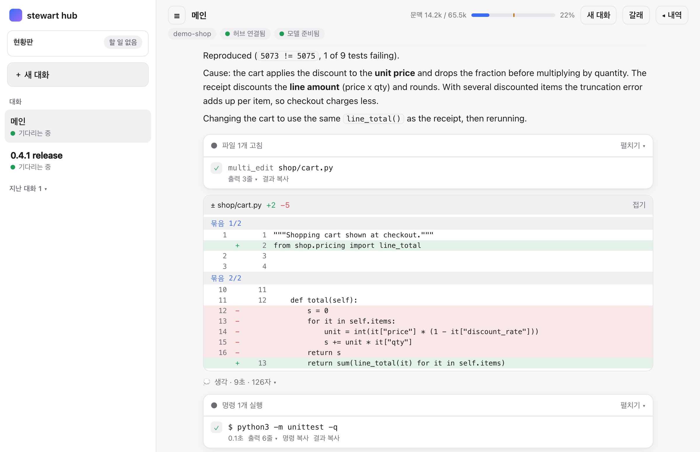
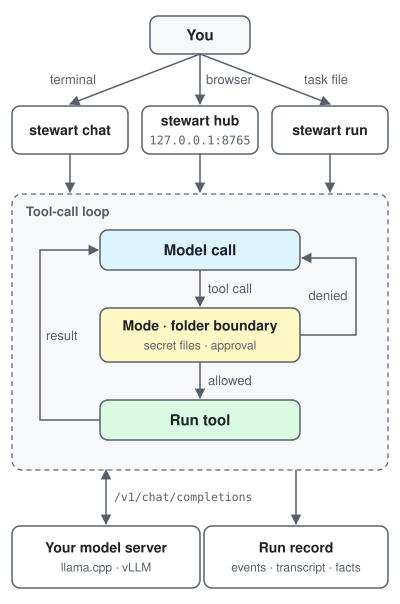

# stewart

[](LICENSE)
[](pyproject.toml)


[](https://github.com/midopa-dept/stewart/actions/workflows/tests.yml)

[Source](https://github.com/midopa-dept/stewart) · [Issues](https://github.com/midopa-dept/stewart/issues) · [stewart-cloud](https://github.com/midopa-dept/stewart-cloud)

**A small agent runner that lets a model you host work on a local folder.**

[한국어](README.md) · English

## Screenshots


*The hub confirming a checkout-total bug with a reproducing test, explaining the cause and fixing it (taken with a demo model that returns scripted answers).*

More: [demo page](docs/demo.en.md) — release prep and a hand-off card in the hub, the terminal, and what each part of the screen is.

## Compared with Claude Code

With the same Claude models on the same coding tasks, stewart used 0.69–0.77× the cost per run, 0.72–0.80× the wall-clock time and 0.25–0.29× the billed tokens of Claude Code. Success rates showed no meaningful difference. This is an exploratory measurement on 16 of our own tasks and should not be read as general performance. The table, conditions and limits are in [the comparison section below](#same-model-different-runner).

## Research and direction

- **Context compaction:** following work showing that masking old tool output is as efficient as summarizing (The Complexity Trap), stewart masks first and summarizes only when that is not enough. The summary format draws on ACON and on writing from Anthropic and OpenHands.
- **Memory:** building on MemGPT and Mem0 (a small always-loaded core plus searchable storage; checking new facts against old memories), memory is split three ways: policy, profile and knowledge.
- **Working with a person:** step plans with check-ins, reflection and hand-off cards came from failures seen in real use, not from papers.
- **Learning from past work:** good patterns are kept as examples and only one is attached to a similar task (no training), and marked runs can be exported as training data ([section below](#learning-from-past-work)).
- [docs/research-notes.md](docs/research-notes.md) lists what each source contributed and where it is in stewart (in, partial, planned).

## Contents

- [How it differs from other runners](#how-it-differs-from-other-runners)
- [Background](#background)
- [Direction](#direction)
- [How it works](#how-it-works)
- [Ways to use it](#ways-to-use-it)
- [Web hub](#web-hub)
- [Tools the model gets](#tools-the-model-gets)
  - [Worker tier names](#worker-tier-names)
- [Safety](#safety)
- [Memory](#memory)
- [Learning from past work](#learning-from-past-work)
- [Same model, different runner](#same-model-different-runner)
- [Install and first run](#install-and-first-run)
- [Configuration](#configuration)
- [Credits and references](#credits-and-references)
- [License](#license)

## How it differs from other runners

Feature differences checked against each project's official docs and repository on 2026-11-11. Sources are listed in [docs/research-notes.md](docs/research-notes.md#다른-실행기-비교의-근거).

| | stewart | OpenCode | Pi | Claude Code | Codex CLI |
|---|---|---|---|---|---|
| License | Apache-2.0 | MIT | MIT | Not open source | Apache-2.0 |
| Models | Any OpenAI-compatible server, Anthropic API | Many providers, OpenAI-compatible | Many providers, OpenAI-compatible | Claude models only | Many providers, Ollama and LM Studio |
| Interfaces | Terminal, web hub (phone browser and notifications) | Terminal, desktop (beta), IDE | Terminal, SDK | Terminal, IDE, desktop, web, mobile | Terminal, IDE, desktop, web |
| MCP | No | Yes | Yes | Yes | Yes |
| LSP (language servers) | No | Built in (off by default) | Not confirmed | Plugins | Not confirmed |
| Plugins / extensions | No (skills and hooks only) | JS/TS plugins | TS extensions | Plugin marketplace | Plugins |
| Skills (SKILL.md) | Yes | Yes | Yes | Yes | Yes |
| OS sandbox for shell commands | Not per command; the whole hub can run in the macOS sandbox | No | No | Yes (off by default) | Yes (on by default) |
| GitHub stars | Early-stage project | 226k | 121k | 155k (issues repo) | 135k |

- **When stewart fits:** when you work with a small open model you host, or an API with weak function calling. The runner carries guards for that: compaction that masks first and summarizes only when needed, turning reflection into enforced prohibitions, hand-off cards, repeated-error detection, nudges to check the web, text-form tool calls, and repair of broken tool calls. It also fits when you want to approve work from a browser or phone across several conversations and workers, or prefer Korean instructions.
- **When another runner fits better:** when you need MCP servers, language servers or IDE integration; when a plugin ecosystem, a large user base and frequent releases matter; or when every shell command must run in an OS sandbox by default (Codex CLI). If you only use Claude models, Claude Code is the most closely tuned to them.
- There is no side-by-side measurement against OpenCode or Pi on the same model yet (planned). The only measurement is the [efficiency comparison with Claude Code](#same-model-different-runner).

## Background

stewart started as a way to get a Claude Code style workflow from small open models you run yourself, roughly the size that fits a 24 GB graphics card at 4 bits. Such models tend to break tool calls, repeat the same attempt and drift on long context, so the runner gained guards for those one at a time. It now connects to OpenAI-compatible servers, the Anthropic API and other API providers.

Each run records when each guard fired, so you can measure which ones actually help. Guards such as retries, memory, skills and reflection are on only in chat and the hub; `run` (the evaluation path) keeps the older behavior so comparisons stay stable.

## Direction

- A test that a person's prohibitions survive compaction
- Measuring on public benchmarks such as Terminal-Bench, and baselines against other runners on the same model
- Optional embedding re-ranking for document search

## How it works



stewart connects to an OpenAI-compatible server such as vLLM or llama.cpp (or the Anthropic Messages API) and lets the model read and edit files, run shell commands and search the web through tools. No model is included. You start the server and stewart connects to it.

Every run leaves a record, so you can check what the model said it did against the files it actually changed and the commands it actually ran. Prompts and tool messages are in Korean.

## Ways to use it

| Command | What it does |
|---|---|
| `stewart chat` | Talk to the model in the terminal. The default mode is `edits` |
| `stewart hub` | The same work in a browser. One main conversation can start several worker sessions |
| `stewart run` | Run one task to the end without a person (`auto` or `--plan`) |

Other commands: `ping` (check the server), `backends`, `profiles`, `rewind`, `dream` (memory upkeep), `sessions` (clean up past hub sessions), `hub-user` (hub accounts), `organize` (folder clean-up plans), `queue` and `bench` (run many tasks), `improve` (learn from past conversations), `train` (export training data, teacher runs), `adapter` (LoRA adapters). See `stewart <command> --help`.

## Web hub

```bash
uv run stewart hub --project ~/my-project
```

- It serves `http://127.0.0.1:8765/`. The first-login token is in `hub-token` in the hub folder; `stewart hub url` shows it again.
- On the screen
  - Approval bar: allow or deny what the model asks to run. ⌘/Ctrl+Enter allows, ⇧⌘/Ctrl+Backspace denies.
  - Conversation: edits show as diff cards with line numbers, thinking as a folding block, and every code block has a copy button.
  - Hand-off card: when the model reaches something only a person can do (a password, keychain prompt, sudo, a login), it stops retrying and hands it to you.
  - Several conversations: start a new main conversation, branch the current one, or reopen a closed one. Approvals and stops apply per conversation. `/clear`, `/reset` and `/help` work.
  - Side panel: board, memory, steps, plan, always-allow rules, tokens, status (backend, mode, thinking, context budget, estimated fixed-prefix tokens, tool list).
  - Past conversation search: the search box in the sidebar finds words in your messages and the model's replies in past conversations and opens them.
  - Input: `/commands`, `@file`, pasted images. Large phone photos and HEIC are shrunk in the browser to 1600 px JPEG.
  - Header: switch the mode (plan, ask, edit, auto) and thinking (default, on, off), and shrink this conversation's context budget (the window compaction is measured against). The mode cannot go wider than the one the hub was started with.
  - Changed-files card: when a turn ends, the files it created or changed show with Open and Download. Markdown is rendered; images and PDFs open in a new tab. Clicking a path in code inside a reply also opens it. Files outside the working folder or with secret-looking names are refused, and HTML and SVG are download-only.
  - Rewind: ↶ on one of your messages removes that turn and restores the files tools changed after it; your message comes back to the input box. ↶ on the files card restores the files only. Files changed by shell commands cannot be restored.
  - Uploads and choices: 📎 in the input box puts documents, spreadsheets or PDFs in `inbox/` in the working folder (up to 20 MB, never overwriting). When the model asks with options, pick one with the buttons under the question.
  - Worker strip: concurrent workers' state, elapsed time and uncollected results show above the conversation. If a worker finishes after the main turn has ended, the hub opens one turn by itself to collect it (up to 3 in a row; `STEWART_AUTO_WAKE=0` turns this off).
  - Model server status dot: ready, starting, unreachable, auth refused.
- Slim main for small models: put `slim = true` on a tier in the backends table and start with `stewart hub --tier <that name>`. The main conversation's fixed prefix (system prompt plus tool definitions) drops from about 13k tokens to under 4k.
  - The model sees one short instruction and ten core tools; the rest can be turned on from the [tools N ▾] chip in the header. The skill index carries names only.
  - Bigger jobs go to workers via `workers`. Workers run with their own profile and tier, and `-b` stays the workers' default backend (a small model for the main, a large one for workers).
  - Measure the reduction with `stewart profiles --cost --slim`.
- New approvals raise a browser notification. Set `[hub] ntfy_url` to also send them to your phone with [ntfy](https://ntfy.sh).
- By default the hub listens on loopback only (`127.0.0.1`, `::1`). To use it from another device, put something in front (an SSH tunnel, for example) or turn on account mode.
  - Account mode: set `accounts = true`, `listen = "<address>"` and `user_root = "<root of per-person working folders>"` under `[hub]`, then add people with `stewart hub-user add <name>`. Each person gets their own sessions, conversations, approvals and working folder.
  - Passwords are stored with scrypt. Sessions last 12 hours, or end after 2 idle hours.
  - It never binds to all addresses (`0.0.0.0`). There is no TLS, so keep it on a private network.

## Tools the model gets

| Group | Tools |
|---|---|
| Files | `read_file` `list_dir` `search` `glob` `write_file` `edit_file` `multi_edit` `notebook_edit` `view_image` (when the backend has `vision = true`) |
| Shell | `run_shell` (keeps state, up to 4 background jobs) `shell_output` `shell_kill` |
| Web | `web_search` (SearXNG) `web_fetch` |
| Find | `doc_search`: BM25 search over documents and code in the working folder, plus web pages already fetched |
| Memory | `memory_search` `memory_read` `note_add` |
| Flow | `todo_write` `todo_read` `ask_user` `delegate` (a worker with its own context) `workers` (concurrent workers) `load_skill` |

- `web_fetch` refuses private, loopback, link-local and CGNAT addresses and re-checks redirects. Fetched text reaches the model wrapped in outside-content markers.
- In chat and the hub, `web_fetch` and `doc_search` are on even without a search address. `run` uses only what the profile and environment variables turn on.
- Seventeen built-in skills are on in chat and the hub: step plans, error diagnosis, git work, code review, security review, simplify, fixing tests, run-and-check, web research, deep research, document files (PDF, Word, Excel, PowerPoint), project init, skill creator, stewart config, hand-off notes, reporting a blocker, memory consolidation. A user or project skill with the same name wins (`STEWART_BUILTIN_SKILLS=0` turns them off).
- Concurrent workers (`workers`, chat and hub): the main conversation spawns workers and keeps going, then gathers their results (wait, collect, cancel, list).
  - Workers run in a fresh context and never ask the person. They skip actions that need approval and note them in their result.
  - The concurrency cap is `STEWART_SPAWN_MAX` (default: the backend's concurrency − 1); `STEWART_SPAWN=0` turns workers off.
  - Worker tiers: `[tiers.<name>]` in the backends table bundles a backend, profile, context budget and concurrency cap. The model sees only each tier's name and a one-line use; if it does not pick one, the runner picks by the kind of work (read-only or not). The default example uses `presto`, `moderato` and `largo` ([Worker tier names](#worker-tier-names)).

### Worker tier names

- A tier is a way of giving work, not a model size. It bundles prompt weight, tools, thinking and context budget under one name.
- The default example has four. Names are set only in `[tiers.<name>]` in the backends table, so renaming them changes no code. The full example is at the end of `backends.example.toml`.
- Tiers work with a single model too; the same model is just used at different weights. A tier without `backend` uses the default model; add one `backend` line when you have another model.
- How many workers run at once is set by the model server's concurrent-request setting (the backend's `concurrency`). A tier's `max` can lower it further.
- If a tier's server cannot be reached, it does not fall back to the default model. A worker notes this and ends; with `--tier` the hub says so at startup. Unknown tiers are refused, listing the ones that exist.
- Thinking fields: `think`, `think_max_tokens` and `think_max_tokens_first`, `reasoning_effort` and `reasoning_effort_at`, `think_sampling`. The same can be set with `STEWART_THINK_*` and `STEWART_REASONING_*` environment variables. Environment variables win over tiers, and tiers over profiles.
- A tier's context budget is the compaction window for both a main seated with `--tier` and workers started on that tier. Runs without a tier behave as before.
- Tags read "seat · tier" (worker 3 · `presto` / main · `largo`).

#### Presto, ma non troppo
- `presto`: quickly. Finding, reading, summarizing, things to double-check.
- A thin prompt, read tools and a short context. Light enough to run several as workers. With `slim = true`, seating it as the main gives the slim hub.

#### Moderato cantabile
- `moderato`: at a moderate pace. The default for coding and conversation.
- The default tier for work that lists tools (writes).

#### Largo ma non tanto
- `largo`: broadly. Planning, dispatching, review.
- Seated as the main with every tool and a wide context (`stewart hub --tier largo`).

#### Rubato, poi a tempo
- `rubato`: stolen time. Only when stuck; paid.
- An external API. It is not in the tier table; it runs as a separately started instance (`stewart instance`), only when a person opens it.
- The default model is never used in its place.

## Safety

stewart runs shell commands the model chooses on your machine. The guards below reduce mistakes; they are not isolation. Run unfamiliar repositories and unattended runs in a container, a virtual machine or a separate account.

- **Modes:** `auto` (run at once), `edits` (edit files at once, ask before shell), `ask` (ask for everything but reading), `plan` (read only).
- **Working-folder boundary:** paths are resolved with realpath and parent folders are compared by inode, so symlinks cannot lead outside. Writes outside the folder are denied in `run` and asked about in chat and the hub, whatever the mode. Adjust with the profile keys `extra_write_dirs` and `read_outside` (allow, ask, deny).
- **Limits of the shell check:** only common write forms are checked (redirects, `rm`, `mv`, `cp`, `sed -i` and similar). Paths with variables or substitutions, writes inside other programs such as `python -c`, and `bash -c` or `eval` are not seen.
- **Secret files:** `.env`, keys, certificates, `.netrc` and similar files are neither read nor written by the tools, and reading them through the shell is blocked too. Templates such as `.env.example` are allowed.
- **Config folders:** writes to `~/.config/stewart` or the hub folder are always asked about in chat and denied in `run`.
- **Shell environment:** the model's shell does not see stewart's virtual environment, `STEWART_*` variables, or variables holding stewart's install path. API keys are read from the environment variable named in the backend file.
- **Hooks:** `SessionStart`, `PreToolUse`, `PostToolUse`, `Stop`. A hook gets JSON on stdin; exit code 2 blocks the action. Hooks are read from user profiles only.
- **Loops:** when the same error shows up three times or the same call repeats, the model is told; if it keeps going, the run stops.

## Memory

- On by default in chat and the hub, off in `run` and `bench`. `STEWART_MEMORY=0|1` or the profile key `memory` overrides this.
- Memory is split three ways and kept in Markdown files you can open and edit, scoped to all projects or to this project.
  - Policy (`policy.md`): lasting instructions such as "from now on …" or "don't …". Always loaded into the prompt.
  - Profile (`profile.md`): short facts such as language, role and preferences. Always loaded, within a small cap.
  - Knowledge (`knowledge/`): facts the model did not know or got wrong and you corrected. Not loaded into the prompt; found with `doc_search`.
- Instructions marked as lasting ("from now on") are offered as policy; instructions for the current turn only are not saved. The hub's memory tab lets you view, edit and delete entries.
- `stewart dream` gathers notes into a proposed `MEMORY.md` per subject. Nothing changes until you take it with `--accept`. The hub makes proposals by itself when idle (`STEWART_DREAM_AUTO=0` turns that off).
- Memory consolidation: `/memory` or "clean up my memory" in the hub, `stewart memory consolidate` in the terminal. The model reads the three parts once and proposes moves between parts, merges, removal candidates and shorter rewrites; you take or keep each item. A copy is saved before anything is applied and `--revert` restores it (`--dry-run` only shows the proposals).
- Hand-written rule files (`AGENTS.md`, `STEWART.md`) win over memory when they conflict.
- The memory folder is `~/.local/share/stewart/memory` (`STEWART_MEMORY_DIR`).

## Learning from past work

There are two ways: learning from past conversations without training, and exporting them as training data. Either way, only what a person picks and accepts is kept.

- **Marking:** press 👍 or 👎 on a reply in the hub, or type `/good` or `/bad` in chat. When the next message asks for a correction, the previous turn gets a "corrected" tag (click to remove it).
- **Example bank:** good patterns live in `examples.md` in the memory folder. At the start of a turn, only **one** example, the one sharing the most words with your message, is appended to your message. The system prompt stays the same, so the prompt cache is not broken. Turn it off with `STEWART_EXAMPLES=0`.
- **Learn from past conversations:** `/improve` or "learn from past conversations" in the hub, or `stewart improve` in the terminal.
  - The model reads the 👍 and corrected turns once and proposes examples, policies and skill drafts.
  - Code re-checks that the cited turns exist, and checks secrets, length and overlap. You take or keep each item.
  - Skill drafts are kept aside and only turn on once you move them in.
  - A copy is saved before anything is applied, and `--revert` restores it. `--stats` compares 👍 and correction rates for turns with and without an example.
  - With an external API backend, the selected turns go to that provider, so it asks first.
- **Export as training data:** `stewart train export` writes the marked turns as OpenAI chat JSONL.
  - Secrets, home paths and user names are masked; engine nudges and failed calls are left out.
  - By default it filters by a table of terms tiers per data source.
  - `stewart train teacher` runs a task pool with test commands on another backend and keeps only runs whose tests pass, with cost and run caps.
  - Training and evaluation are handled by the separate tool [stewart-tune](https://github.com/midopa-dept/stewart-tune).
- **Choosing a LoRA adapter:** `adapters` and `adapter` in the backends table pick an adapter loaded on the server (the model field for vLLM, the lora field for llama.cpp).
  - `STEWART_ADAPTER=off` goes back to the base model in one line.
  - `stewart adapter` checks that it is loaded on the server.

## Same model, different runner

We attached the same Claude models to stewart and to Claude Code (2.1.311), gave both the same coding tasks, and compared cost, time and tokens. This is an exploratory measurement outside our pre-registered study.

| Model | stewart | Wall-clock ratio | Cost per run ratio | Billed tokens ratio |
|---|---|---|---|---|
| `claude-sonnet-5-5` | dev build 72 | 0.80 [0.71, 0.91] | 0.73 [0.62, 0.83] | 0.29 [0.24, 0.34] |
| `claude-sonnet-5-5` | dev build 10 + Anthropic backend | 0.77 [0.71, 0.84] | 0.69 [0.57, 0.80] | 0.26 [0.22, 0.30] |
| `claude-opus-5-5` | dev build 72 | 0.72 [0.65, 0.78] | 0.77 [0.64, 0.90] | 0.25 [0.20, 0.29] |
| `claude-opus-5-5` | dev build 10 + Anthropic backend | 0.72 [0.67, 0.77] | 0.76 [0.64, 0.89] | 0.25 [0.20, 0.30] |

- Ratio = stewart ÷ Claude Code (ratio of per-task means). Below 1 means stewart used less. Brackets are 95% intervals from a task-level bootstrap.
- Median per run: Sonnet, stewart 15–17 s and $0.05–0.06 vs Claude Code 20 s and $0.08; Opus, stewart 22 s and $0.09–0.10 vs Claude Code 29 s and $0.14.
- Most of the token difference comes from the size of the system instructions and tool definitions sent with every request.
- Success rates (hidden tests pass and instructions followed) showed no meaningful difference between the two runners, so they are not reported here.

Conditions
- Tasks: 16 of our own unpublished tasks (part of the v2 development set). The held-out evaluation set was not used. Each task ran 1–2 times with stewart and 5–22 times with Claude Code.
- Dates: stewart 2026-11-11, Claude Code 2026-11-10. Same evaluator, tasks and grading code.
- stewart: adaptive thinking (default effort), `code` profile, web off, prompt caching on. Claude Code: product defaults, acceptEdits, one added line of evaluation rules, auto memory off.
- Cost: for both runners, the tokens reported by the API (input, output, cache reads, cache writes) times the same public price table.

Limits
- The tasks, evaluator and hidden tests are not public yet (planned with the study), so others cannot rerun this today.
- Claude Code was measured a day earlier. API latency varies by day and hour, which affects the wall-clock comparison; cost and token comparisons do not depend on the day.
- The 16 tasks were chosen to show success-rate differences between models and runners; they are not a random sample. The efficiency ratios may differ on other tasks.
- Each runner used its own default thinking settings; they are not guaranteed to be equivalent.
- The cost Claude Code reported for itself was higher than the price-table cost of the same tokens (1.47× for Opus). The table uses the price-table cost, not actual billing.
- One person measured this on one Mac.

## Install and first run

You need [uv](https://docs.astral.sh/uv/) and git. [ripgrep](https://github.com/BurntSushi/ripgrep) makes `search` faster.

```bash
git clone https://github.com/midopa-dept/stewart.git
cd stewart
uv sync
mkdir -p ~/.config/stewart
cp backends.example.toml ~/.config/stewart/backends.toml
```

Start a model that supports tool calls with `llama-server` from [llama.cpp](https://github.com/ggml-org/llama.cpp):

```bash
llama-server -m <model.gguf> --port 8080 --ctx-size 16384 --jinja
```

`[backends.local]` in `backends.toml` points to `http://127.0.0.1:8080/v1`. Set `model` to the name the server reports, then try:

```bash
uv run stewart ping -b local
uv run stewart chat --backend local --workdir ~/my-project
uv run stewart hub --project ~/my-project
uv run stewart run -p code --backend local --workdir ~/my-project --task "Fix the failing test"
```

### Anthropic API

```bash
uv sync --extra anthropic
export ANTHROPIC_API_KEY=...   # keep the key in the environment only
```

Add a backend with `kind = "anthropic"` to `backends.toml`; there is an example at the end of `backends.example.toml`. The key variable is not passed to the model's shell.

### Other APIs

`backends.providers.example.toml` has examples for providers such as EXAONE, OpenAI, Gemini and OpenRouter. Copy it, enable only the entries you want, and point `STEWART_BACKENDS=<copy>` at it.

- Give the key as an environment variable name (`api_key_env`) or a macOS keychain item name (`api_key_keychain`). Either way the key is not passed to the model's shell.
- APIs without a function-calling field can use `tool_mode = "text"` for text-form tool calls.
- With `provider` set, the hub shows that your work is sent to an outside company. Check each provider's terms and prices.
- To run a separate hub on an outside API, use `stewart instance <name> start`. It gets its own config, state and memory folders (`stewart-<name>`), runs inside the macOS sandbox, and cannot read the keychain from inside.

### Rented GPU

For bigger models on a rented GPU, see [stewart-cloud](https://github.com/midopa-dept/stewart-cloud). If you run vLLM yourself, turn on `--enable-auto-tool-choice --tool-call-parser <parser for your model>` and keep the port off the internet: reach it through an SSH tunnel or a private network.

### Windows

Install and run the same way (`uv sync`, `uv run stewart`). `run_shell` needs a shell, so provide one of these:

- Put [busybox-w32](https://frippery.org/busybox/) in the repository as `bin\busybox64u.exe`.
- Set the environment variable `STEWART_SHELL` to a shell executable.
- Set `[shell] path` in `~/.config/stewart/config.toml`.

Git bash also works, but its `/c/…` paths do not yet match the folder-boundary check, so stewart warns about it.

## Configuration

| What | Where |
|---|---|
| Backends | `STEWART_BACKENDS` → `~/.config/stewart/backends.toml` → `backends.toml` in the repository |
| Hub | `~/.config/stewart/hub.toml` (`STEWART_HUB_CONFIG`). `[hub]` (port, notifications, accounts), `[web]` (search address) |
| Your profiles | `~/.config/stewart/profiles/`. Inherit with `extends = "code"` and write only what changes |
| Project instructions | `AGENTS.md`, `STEWART.md`, `~/.config/stewart/STEWART.md` |
| Run records | `~/.local/state/stewart/runs/` |

```toml
# ~/.config/stewart/backends.toml
default = "local"

[backends.local]
base_url = "http://127.0.0.1:8080/v1"
model = "local-model"
max_context = 16384          # with vLLM it is re-read from max_model_len at start
timeout_s = 600
# api_key_env = "MY_KEY_ENV"  # name of the variable holding the key; never the key itself

[backends.local.params]       # merged into every request body
temperature = 0.2
```

```toml
# ~/.config/stewart/hub.toml
[web]
url = "<SearXNG address>"   # SearXNG with JSON output enabled. backend = "none" turns web tools off
```

- Thinking: `--think` and `/think` in chat, `STEWART_THINK_MAX_TOKENS`, `STEWART_THINK_SAMPLING`.
- Check before finishing: the profile key `check_on_stop` (on in the `code` profile).
- Tests: `uv run python -m unittest discover -s tests -t .` runs against fake servers only and needs no network.

### Built-in profiles

| Name | Use |
|---|---|
| `chat` | Interactive coding, all tools |
| `code` | Change code and confirm with tests |
| `manager` · `worker` · `verifier` | Split work, hand it to workers, let a verifier judge |
| `research` | Search the web and summarize with sources |
| `organize` | Scan a folder and only plan the moves |
| `media` | Suggest places for media files that failed to sort |

## Credits and references

- How research sources map to stewart: [docs/research-notes.md](docs/research-notes.md) (Korean)
- Parts of the web UI (`ui/`) adapt layouts and code from the MIT-licensed projects [llama.cpp](https://github.com/ggml-org/llama.cpp), [opencode](https://github.com/anomalyco/opencode) and [OpenHands](https://github.com/OpenHands/OpenHands). The parts and full license texts are in [ui/THIRD_PARTY.md](ui/THIRD_PARTY.md); bundled packages are listed in [NOTICE](NOTICE).
- Anthropic [Claude Code](https://docs.anthropic.com/en/docs/claude-code) docs: run modes, hooks, todos, memory files, sub-agents
- Anthropic, "The components of agent memory": memory layers (records, notes, pages, injected index)
- Qwen3 model card: recommended sampling for thinking mode (`STEWART_THINK_SAMPLING=qwen`)
- [vLLM](https://github.com/vllm-project/vllm), [SearXNG](https://github.com/searxng/searxng), [uv](https://github.com/astral-sh/uv), [ntfy](https://ntfy.sh), [busybox-w32](https://frippery.org/busybox/)

## License

Apache License 2.0. See [LICENSE](LICENSE) and [NOTICE](NOTICE).
