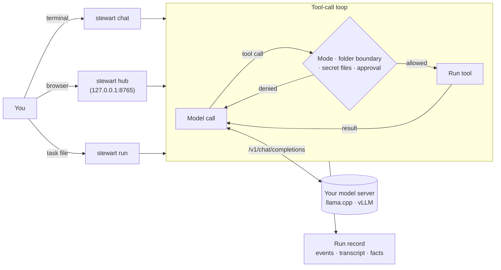

# stewart

[](LICENSE)
[](pyproject.toml)


[](https://github.com/midopa-dept/stewart/actions/workflows/tests.yml)

[Source](https://github.com/midopa-dept/stewart) · [Issues](https://github.com/midopa-dept/stewart/issues) · [stewart-cloud](https://github.com/midopa-dept/stewart-cloud)

**A small agent runner that lets a model you host work on a local folder.**

[한국어](README.md) · English



stewart connects to an OpenAI-compatible server such as vLLM or llama.cpp (or the Anthropic Messages API) and lets the model read and edit files, run shell commands and search the web through tools. No model is included. You start the server and stewart connects to it.

Every run leaves a record, so you can check what the model said it did against the files it actually changed and the commands it actually ran. Prompts and tool messages are in Korean.

## Ways to use it

| Command | What it does |
|---|---|
| `stewart chat` | Talk to the model in the terminal. The default mode is `edits` |
| `stewart hub` | The same work in a browser. One main conversation can start several worker sessions |
| `stewart run` | Run one task to the end without a person (`auto` or `--plan`) |

Other commands: `ping` (check the server), `backends`, `profiles`, `rewind`, `dream` (memory upkeep), `sessions` (clean up past hub sessions), `hub-user` (hub accounts), `organize` (folder clean-up plans), `queue` and `bench` (run many tasks). See `stewart <command> --help`.

## Web hub

```bash
uv run stewart hub --project ~/my-project
```

- It serves `http://127.0.0.1:8765/`. The first-login token is in `hub-token` in the hub folder; `stewart hub url` shows it again.
- On the screen
  - Approval bar: allow or deny what the model asks to run. ⌘/Ctrl+Enter allows, ⇧⌘/Ctrl+Backspace denies.
  - Conversation: edits show as diff cards with line numbers, thinking as a folding block, and every code block has a copy button.
  - Hand-off card: when the model reaches something only a person can do (a password, keychain prompt, sudo, a login), it stops retrying and hands it to you.
  - Several conversations: start a new main conversation, branch the current one, or reopen a closed one. Approvals and stops apply per conversation. `/clear`, `/reset` and `/help` work.
  - Side panel: board, memory, steps, plan, always-allow rules, tokens.
  - Input: `/commands`, `@file`, pasted images. Large phone photos and HEIC are shrunk in the browser to 1600 px JPEG.
  - Model server status dot: ready, starting, unreachable, auth refused.
- New approvals raise a browser notification. Set `[hub] ntfy_url` to also send them to your phone with [ntfy](https://ntfy.sh).
- By default the hub listens on loopback only (`127.0.0.1`, `::1`). To use it from another device, put something in front (an SSH tunnel, for example) or turn on account mode.
  - Account mode: set `accounts = true`, `listen = "<address>"` and `user_root = "<root of per-person working folders>"` under `[hub]`, then add people with `stewart hub-user add <name>`. Each person gets their own sessions, conversations, approvals and working folder.
  - Passwords are stored with scrypt. Sessions last 12 hours, or end after 2 idle hours.
  - It never binds to all addresses (`0.0.0.0`). There is no TLS, so keep it on a private network.

## Tools the model gets

| Group | Tools |
|---|---|
| Files | `read_file` `list_dir` `search` `glob` `write_file` `edit_file` `multi_edit` `notebook_edit` `view_image` (when the backend has `vision = true`) |
| Shell | `run_shell` (keeps state, up to 4 background jobs) `shell_output` `shell_kill` |
| Web | `web_search` (SearXNG) `web_fetch` |
| Find | `doc_search`: BM25 search over documents and code in the working folder, plus web pages already fetched |
| Memory | `memory_search` `memory_read` `note_add` |
| Flow | `todo_write` `todo_read` `ask_user` `delegate` (a worker with its own context) `load_skill` |

- `web_fetch` refuses private, loopback, link-local and CGNAT addresses and re-checks redirects. Fetched text reaches the model wrapped in outside-content markers.
- In chat and the hub, `web_fetch` and `doc_search` are on even without a search address. `run` uses only what the profile and environment variables turn on.
- Sixteen built-in skills are on in chat and the hub: step plans, error diagnosis, git work, code review, security review, simplify, fixing tests, run-and-check, web research, deep research, document files (PDF, Word, Excel, PowerPoint), project init, skill creator, stewart config, hand-off notes, reporting a blocker. A user or project skill with the same name wins (`STEWART_BUILTIN_SKILLS=0` turns them off).

## Safety

stewart runs shell commands the model chooses on your machine. The guards below reduce mistakes; they are not isolation. Run unfamiliar repositories and unattended runs in a container, a virtual machine or a separate account.

- **Modes:** `auto` (run at once), `edits` (edit files at once, ask before shell), `ask` (ask for everything but reading), `plan` (read only).
- **Working-folder boundary:** paths are resolved with realpath and parent folders are compared by inode, so symlinks cannot lead outside. Writes outside the folder are denied in `run` and asked about in chat and the hub, whatever the mode. Adjust with the profile keys `extra_write_dirs` and `read_outside` (allow, ask, deny).
- **Limits of the shell check:** only common write forms are checked (redirects, `rm`, `mv`, `cp`, `sed -i` and similar). Paths with variables or substitutions, writes inside other programs such as `python -c`, and `bash -c` or `eval` are not seen.
- **Secret files:** `.env`, keys, certificates, `.netrc` and similar files are neither read nor written by the tools, and reading them through the shell is blocked too. Templates such as `.env.example` are allowed.
- **Config folders:** writes to `~/.config/stewart` or the hub folder are always asked about in chat and denied in `run`.
- **Shell environment:** the model's shell does not see stewart's virtual environment, `STEWART_*` variables, or variables holding stewart's install path. API keys are read from the environment variable named in the backend file.
- **Hooks:** `SessionStart`, `PreToolUse`, `PostToolUse`, `Stop`. A hook gets JSON on stdin; exit code 2 blocks the action. Hooks are read from user profiles only.
- **Loops:** when the same error shows up three times or the same call repeats, the model is told; if it keeps going, the run stops.

## Memory

- On by default in chat and the hub, off in `run` and `bench`. `STEWART_MEMORY=0|1` or the profile key `memory` overrides this.
- When you say something the model should keep doing next time, it saves a note, scoped to all projects (user) or this project (project). The hub's memory tab lets you view, edit and delete them.
- `stewart dream` gathers notes into a proposed `MEMORY.md` per subject. Nothing changes until you take it with `--accept`. The hub makes proposals by itself when idle (`STEWART_DREAM_AUTO=0` turns that off).
- Hand-written rule files (`AGENTS.md`, `STEWART.md`) win over memory when they conflict.
- The memory folder is `~/.local/share/stewart/memory` (`STEWART_MEMORY_DIR`).

## Same model, different runner

We attached the same Claude models to stewart and to Claude Code (2.1.311), gave both the same coding tasks, and compared cost, time and tokens. This is an exploratory measurement outside our pre-registered study.

| Model | stewart | Wall-clock ratio | Cost per run ratio | Billed tokens ratio |
|---|---|---|---|---|
| `claude-sonnet-5-5` | dev build 72 | 0.80 [0.71, 0.91] | 0.73 [0.62, 0.83] | 0.29 [0.24, 0.34] |
| `claude-sonnet-5-5` | dev build 10 + Anthropic backend | 0.77 [0.71, 0.84] | 0.69 [0.57, 0.80] | 0.26 [0.22, 0.30] |
| `claude-opus-5-5` | dev build 72 | 0.72 [0.65, 0.78] | 0.77 [0.64, 0.90] | 0.25 [0.20, 0.29] |
| `claude-opus-5-5` | dev build 10 + Anthropic backend | 0.72 [0.67, 0.77] | 0.76 [0.64, 0.89] | 0.25 [0.20, 0.30] |

- Ratio = stewart ÷ Claude Code (ratio of per-task means). Below 1 means stewart used less. Brackets are 95% intervals from a task-level bootstrap.
- Median per run: Sonnet, stewart 15–17 s and $0.05–0.06 vs Claude Code 20 s and $0.08; Opus, stewart 22 s and $0.09–0.10 vs Claude Code 29 s and $0.14.
- Most of the token difference comes from the size of the system instructions and tool definitions sent with every request.
- Success rates (hidden tests pass and instructions followed) showed no meaningful difference between the two runners, so they are not reported here.

Conditions
- Tasks: 16 of our own unpublished tasks (part of the v2 development set). The held-out evaluation set was not used. Each task ran 1–2 times with stewart and 5–22 times with Claude Code.
- Dates: stewart 2026-11-11, Claude Code 2026-11-10. Same evaluator, tasks and grading code.
- stewart: adaptive thinking (default effort), `code` profile, web off, prompt caching on. Claude Code: product defaults, acceptEdits, one added line of evaluation rules, auto memory off.
- Cost: for both runners, the tokens reported by the API (input, output, cache reads, cache writes) times the same public price table.

Limits
- The tasks, evaluator and hidden tests are not public yet (planned with the study), so others cannot rerun this today.
- Claude Code was measured a day earlier. API latency varies by day and hour, which affects the wall-clock comparison; cost and token comparisons do not depend on the day.
- The 16 tasks were chosen to show success-rate differences between models and runners; they are not a random sample. The efficiency ratios may differ on other tasks.
- Each runner used its own default thinking settings; they are not guaranteed to be equivalent.
- The cost Claude Code reported for itself was higher than the price-table cost of the same tokens (1.47× for Opus). The table uses the price-table cost, not actual billing.
- One person measured this on one Mac.

## Install and first run

You need [uv](https://docs.astral.sh/uv/) and git. [ripgrep](https://github.com/BurntSushi/ripgrep) makes `search` faster.

```bash
git clone https://github.com/midopa-dept/stewart.git
cd stewart
uv sync
mkdir -p ~/.config/stewart
cp backends.example.toml ~/.config/stewart/backends.toml
```

Start a model that supports tool calls with `llama-server` from [llama.cpp](https://github.com/ggml-org/llama.cpp):

```bash
llama-server -m <model.gguf> --port 8080 --ctx-size 16384 --jinja
```

`[backends.local]` in `backends.toml` points to `http://127.0.0.1:8080/v1`. Set `model` to the name the server reports, then try:

```bash
uv run stewart ping -b local
uv run stewart chat --backend local --workdir ~/my-project
uv run stewart hub --project ~/my-project
uv run stewart run -p code --backend local --workdir ~/my-project --task "Fix the failing test"
```

### Anthropic API

```bash
uv sync --extra anthropic
export ANTHROPIC_API_KEY=...   # keep the key in the environment only
```

Add a backend with `kind = "anthropic"` to `backends.toml`; there is an example at the end of `backends.example.toml`. The key variable is not passed to the model's shell.

### Rented GPU

For bigger models on a rented GPU, see [stewart-cloud](https://github.com/midopa-dept/stewart-cloud). If you run vLLM yourself, turn on `--enable-auto-tool-choice --tool-call-parser <parser for your model>` and keep the port off the internet: reach it through an SSH tunnel or a private network.

### Windows

Install and run the same way (`uv sync`, `uv run stewart`). `run_shell` needs a shell, so provide one of these:

- Put [busybox-w32](https://frippery.org/busybox/) in the repository as `bin\busybox64u.exe`.
- Set the environment variable `STEWART_SHELL` to a shell executable.
- Set `[shell] path` in `~/.config/stewart/config.toml`.

Git bash also works, but its `/c/…` paths do not yet match the folder-boundary check, so stewart warns about it.

## Configuration

| What | Where |
|---|---|
| Backends | `STEWART_BACKENDS` → `~/.config/stewart/backends.toml` → `backends.toml` in the repository |
| Hub | `~/.config/stewart/hub.toml` (`STEWART_HUB_CONFIG`). `[hub]` (port, notifications, accounts), `[web]` (search address) |
| Your profiles | `~/.config/stewart/profiles/`. Inherit with `extends = "code"` and write only what changes |
| Project instructions | `AGENTS.md`, `STEWART.md`, `~/.config/stewart/STEWART.md` |
| Run records | `~/.local/state/stewart/runs/` |

```toml
# ~/.config/stewart/backends.toml
default = "local"

[backends.local]
base_url = "http://127.0.0.1:8080/v1"
model = "local-model"
max_context = 16384          # with vLLM it is re-read from max_model_len at start
timeout_s = 600
# api_key_env = "MY_KEY_ENV"  # name of the variable holding the key; never the key itself

[backends.local.params]       # merged into every request body
temperature = 0.2
```

```toml
# ~/.config/stewart/hub.toml
[web]
url = "<SearXNG address>"   # SearXNG with JSON output enabled. backend = "none" turns web tools off
```

- Thinking: `--think` and `/think` in chat, `STEWART_THINK_MAX_TOKENS`, `STEWART_THINK_SAMPLING`.
- Check before finishing: the profile key `check_on_stop` (on in the `code` profile).
- Tests: `uv run python -m unittest discover -s tests -t .` runs against fake servers only and needs no network.

### Built-in profiles

| Name | Use |
|---|---|
| `chat` | Interactive coding, all tools |
| `code` | Change code and confirm with tests |
| `manager` · `worker` · `verifier` | Split work, hand it to workers, let a verifier judge |
| `research` | Search the web and summarize with sources |
| `organize` | Scan a folder and only plan the moves |
| `media` | Suggest places for media files that failed to sort |

## Credits and references

- Parts of the web UI (`ui/`) adapt layouts and code from the MIT-licensed projects [llama.cpp](https://github.com/ggml-org/llama.cpp), [opencode](https://github.com/anomalyco/opencode) and [OpenHands](https://github.com/OpenHands/OpenHands). The parts and full license texts are in [ui/THIRD_PARTY.md](ui/THIRD_PARTY.md); bundled packages are listed in [NOTICE](NOTICE).
- Anthropic [Claude Code](https://docs.anthropic.com/en/docs/claude-code) docs: run modes, hooks, todos, memory files, sub-agents
- Anthropic, "The components of agent memory": memory layers (records, notes, pages, injected index)
- Qwen3 model card: recommended sampling for thinking mode (`STEWART_THINK_SAMPLING=qwen`)
- [vLLM](https://github.com/vllm-project/vllm), [SearXNG](https://github.com/searxng/searxng), [uv](https://github.com/astral-sh/uv), [ntfy](https://ntfy.sh), [busybox-w32](https://frippery.org/busybox/)

## License

Apache License 2.0. See [LICENSE](LICENSE) and [NOTICE](NOTICE).
