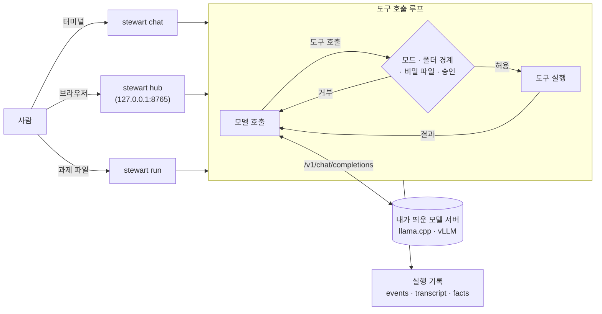

# stewart

[](LICENSE)
[](pyproject.toml)


[](https://github.com/midopa-dept/stewart/actions/workflows/tests.yml)

[Source](https://github.com/midopa-dept/stewart) · [Issues](https://github.com/midopa-dept/stewart/issues) · [stewart-cloud](https://github.com/midopa-dept/stewart-cloud)

**직접 띄운 모델에게 작업 폴더를 맡기는 작은 에이전트 실행기**

A small agent runner that lets a model you host work on a local folder.

한국어 · [English](README.en.md)



vLLM·llama.cpp 같은 OpenAI 호환 서버(또는 Anthropic Messages API)에 붙어, 모델이 도구로 파일을 읽고 고치고 셸 명령을 돌리게 합니다. 모델은 들어 있지 않습니다. 서버는 직접 띄우고 stewart 는 거기에 연결합니다.

실행마다 기록이 남아, 모델이 했다고 말한 일과 실제로 바꾼 파일·돌린 명령을 맞대어 볼 수 있습니다. 프롬프트와 도구 메시지는 한국어입니다.

## 쓰는 길

| 명령 | 하는 일 |
|---|---|
| `stewart chat` | 터미널에서 대화하며 일을 맡깁니다. 기본 모드는 `edits` 입니다 |
| `stewart hub` | 같은 일을 브라우저 화면으로 합니다. 메인 대화 하나에 작업자 세션을 여럿 붙일 수 있습니다 |
| `stewart run` | 과제 하나를 사람 없이 끝까지 돌립니다(`auto` 또는 `--plan`) |

그 밖의 명령: `ping`(서버 확인), `backends`, `profiles`, `rewind`(되돌리기), `dream`(기억 정리), `sessions`(허브의 지난 세션 정리), `hub-user`(허브 계정), `organize`(폴더 정리 계획), `queue`·`bench`(여러 과제 돌리기). 모두 `stewart <명령> --help` 로 볼 수 있습니다.

## 웹 허브

```bash
uv run stewart hub --project ~/my-project
```

- `http://127.0.0.1:8765/` 에 뜹니다. 처음 들어갈 때 쓰는 토큰은 허브 폴더의 `hub-token` 에 있고, `stewart hub url` 로 다시 볼 수 있습니다.
- 화면에서 할 수 있는 것
  - 승인 띠: 모델이 묻는 명령을 허용·거부합니다. ⌘/Ctrl+Enter 는 허용, ⇧⌘/Ctrl+Backspace 는 거부입니다.
  - 대화: 파일 고침은 줄 번호가 붙은 diff 카드로, 생각(thinking)은 접히는 블록으로 보입니다. 코드 블록마다 복사 단추가 있습니다.
  - 사람 손 카드: 비밀번호·키체인·sudo·로그인처럼 사람만 풀 수 있는 곳에 닿으면, 모델이 같은 시도를 되풀이하지 않고 사람에게 넘깁니다.
  - 대화 여럿: 메인 대화를 새로 열거나, 지금 대화에서 갈래를 치거나, 닫은 대화를 다시 열 수 있습니다. 승인과 멈춤은 대화마다 따로입니다. `/clear`·`/reset`·`/help` 를 씁니다.
  - 오른쪽 패널: 현황판, 기억, 단계, 계획, 늘 허용 규칙, 토큰.
  - 입력 칸: `/명령`, `@파일`, 이미지 붙여넣기. 큰 폰 사진·HEIC 는 브라우저에서 긴 변 1600px JPEG 로 줄여 붙입니다.
  - 모델 서버 상태 점: 준비됨, 올라오는 중, 닿지 않음, 인증 거부.
- 새 승인 대기는 브라우저 알림으로 알립니다. `[hub] ntfy_url` 을 적으면 [ntfy](https://ntfy.sh) 로 폰에도 보냅니다.
- 듣는 주소는 기본으로 loopback(`127.0.0.1`·`::1`)뿐입니다. 다른 기기에서 쓰려면 앞단(SSH 터널 등)을 두거나 계정 모드를 켭니다.
  - 계정 모드: `[hub]` 에 `accounts = true`, `listen = "<주소>"`, `user_root = "<사람별 작업 폴더의 뿌리>"` 를 적고 `stewart hub-user add <이름>` 으로 사람을 더합니다. 사람마다 세션·대화·승인·작업 폴더가 따로입니다.
  - 비밀번호는 scrypt 로 저장합니다. 세션은 12시간, 쉬면 2시간에 끝납니다.
  - `0.0.0.0` 같은 모든 주소에는 묶지 않습니다. TLS 는 없으니 사설망 안에서만 쓰십시오.

## 모델이 쓰는 도구

| 무리 | 도구 |
|---|---|
| 파일 | `read_file` `list_dir` `search` `glob` `write_file` `edit_file` `multi_edit` `notebook_edit` `view_image`(백엔드 `vision = true` 일 때) |
| 셸 | `run_shell`(상태 유지, 백그라운드 4개까지) `shell_output` `shell_kill` |
| 웹 | `web_search`(SearXNG) `web_fetch` |
| 찾기 | `doc_search`: 작업 폴더의 문서·코드를 BM25 로 찾습니다. 한 번 읽은 웹 글도 함께 찾습니다 |
| 기억 | `memory_search` `memory_read` `note_add` |
| 흐름 | `todo_write` `todo_read` `ask_user` `delegate`(따로 문맥을 쓰는 작업자) `load_skill` |

- `web_fetch` 는 사설·루프백·링크 로컬·CGNAT 주소로 가지 않고, 리다이렉트도 다시 검사합니다. 가져온 글은 바깥 자료 표시로 감싸 모델에게 줍니다.
- chat 과 허브에서는 검색 주소가 없어도 `web_fetch` 와 `doc_search` 가 켜집니다. `run` 은 프로필과 환경 변수에 적은 것만 씁니다.
- 내장 스킬 16개가 chat·허브에서 켜집니다: 단계 계획, 오류 진단, git 작업, 코드 리뷰, 보안 검토, 정리(simplify), 시험 고치기, 실행해 확인, 웹 조사, 깊은 조사, 문서 파일(PDF·Word·Excel·PowerPoint), 프로젝트 안내 파일 만들기, 스킬 만들기, stewart 설정, 인계 문서, 막힘 보고. 사용자·프로젝트에 같은 이름의 스킬이 있으면 그쪽이 이깁니다(`STEWART_BUILTIN_SKILLS=0` 이면 끔).

## 안전 장치

stewart 는 모델이 고른 셸 명령을 내 기기에서 돌립니다. 아래 장치는 실수를 줄일 뿐 격리가 아닙니다. 처음 보는 저장소나 무인 실행은 컨테이너·가상 기계·전용 계정에서 돌리십시오.

- **모드:** `auto`(바로 실행), `edits`(파일 고침은 바로, 셸은 묻기), `ask`(읽기 말고 모두 묻기), `plan`(읽기만).
- **작업 폴더 경계:** 경로를 realpath 로 풀고 위쪽 폴더를 inode 로 맞대어 봅니다. 링크로 밖에 나가도 잡힙니다. 폴더 밖 쓰기는 `run` 에서 거부하고 chat·허브에서는 모드와 상관없이 묻습니다. 프로필의 `extra_write_dirs` 와 `read_outside`(allow·ask·deny)로 조정합니다.
- **셸 검사의 한계:** 셸 명령은 흔한 쓰기 꼴(리다이렉트, `rm`·`mv`·`cp`·`sed -i` 등)만 봅니다. 변수·치환이 든 경로, `python -c` 같은 다른 프로그램 안의 쓰기, `bash -c`·`eval` 은 보지 못합니다.
- **비밀 파일:** `.env`, 키, 인증서, `.netrc` 같은 파일은 도구가 읽지도 쓰지도 않습니다. 셸로 읽으려 해도 막습니다. 견본(`.env.example`)은 됩니다.
- **설정 폴더:** `~/.config/stewart` 와 허브 폴더에 쓰려 하면 chat 은 늘 묻고 `run` 은 거부합니다.
- **셸 환경:** 모델의 셸에는 stewart 의 가상 환경, `STEWART_*` 변수, 설치 경로가 든 변수가 넘어가지 않습니다. API 키는 백엔드 파일에 적은 이름의 환경 변수에서 읽습니다.
- **hooks:** `SessionStart`·`PreToolUse`·`PostToolUse`·`Stop`. 표준 입력으로 JSON 을 받고 종료 코드 2 면 그 동작을 막습니다. 사용자 프로필에서만 읽습니다.
- **되짚기:** 같은 오류가 세 번 나거나 같은 호출이 되풀이되면 모델에게 알리고, 계속되면 멈춥니다.

## 기억

- chat 과 허브에서는 기본으로 켜지고, `run`·`bench` 에서는 꺼집니다. `STEWART_MEMORY=0|1` 이나 프로필 `memory` 가 이깁니다.
- 대화 중 사람이 "다음에도 이렇게" 라고 한 것을 메모로 남깁니다. 범위는 모든 프로젝트(user)와 이 프로젝트(project) 둘입니다. 허브의 기억 탭에서 보고, 고치고, 지울 수 있습니다.
- 메모는 `stewart dream` 이 대상마다 `MEMORY.md` 제안으로 모읍니다. 사람이 `--accept` 로 들이기 전에는 바뀌지 않습니다. 허브는 한가할 때 제안을 스스로 만듭니다(`STEWART_DREAM_AUTO=0` 이면 끔).
- 손으로 쓴 규칙 파일(`AGENTS.md`, `STEWART.md`)과 부딪히면 규칙 파일이 이깁니다.
- 기억 폴더는 `~/.local/share/stewart/memory`(`STEWART_MEMORY_DIR`)입니다.

## 같은 모델에서 실행기만 바꿨을 때

같은 Claude 모델을 stewart 와 Claude Code(2.1.311)에 각각 붙여 같은 코딩 과제를 풀게 하고, 쓴 비용·시간·토큰을 비교했습니다. 사전 등록한 연구 밖에서 한 탐색 측정입니다.

| 모델 | stewart | 벽시계 비 | 회당 비용 비 | 과금 토큰 비 |
|---|---|---|---|---|
| `claude-sonnet-5-5` | 개발 판 72 | 0.80 [0.71, 0.91] | 0.73 [0.62, 0.83] | 0.29 [0.24, 0.34] |
| `claude-sonnet-5-5` | 개발 판 10 + Anthropic 백엔드 | 0.77 [0.71, 0.84] | 0.69 [0.57, 0.80] | 0.26 [0.22, 0.30] |
| `claude-opus-5-5` | 개발 판 72 | 0.72 [0.65, 0.78] | 0.77 [0.64, 0.90] | 0.25 [0.20, 0.29] |
| `claude-opus-5-5` | 개발 판 10 + Anthropic 백엔드 | 0.72 [0.67, 0.77] | 0.76 [0.64, 0.89] | 0.25 [0.20, 0.30] |

- 비 = stewart ÷ Claude Code(과제별 평균의 비). 1 보다 작으면 stewart 쪽이 적게 썼습니다. 괄호는 과제 단위 붓스트랩 95% 구간입니다.
- 회당 중앙값: Sonnet 은 stewart 15~17초·$0.05~0.06, Claude Code 20초·$0.08. Opus 는 stewart 22초·$0.09~0.10, Claude Code 29초·$0.14.
- 과금 토큰 차이는 대부분 매 요청에 실리는 시스템 지시·도구 정의의 크기 차이로 봅니다.
- 성공률(숨긴 시험 통과 + 지시 준수)은 두 실행기 사이에 가를 만한 차이가 없어 싣지 않았습니다.

조건
- 과제: 공개 전 자체 과제 16개(v2 개발 묶음의 일부). 따로 떼어 둔 평가용(보류) 묶음은 쓰지 않았습니다. 과제마다 stewart 1~2회, Claude Code 5~22회.
- 측정일: stewart 2026-11-11, Claude Code 2026-11-10. 같은 평가기·같은 과제·같은 채점 코드.
- stewart: 생각 adaptive(노력 기본값), `code` 프로필, 웹 끔, 프롬프트 캐시 켬. Claude Code: 제품 기본 설정, acceptEdits, 평가 규칙 한 줄만 덧붙임, 자동 기억 끔.
- 비용: 두 실행기 모두 API 가 보고한 토큰(입력·출력·캐시 읽기·캐시 쓰기)에 같은 공식 단가표를 곱했습니다.

한계
- 과제·평가기·숨긴 시험은 아직 비공개입니다(연구와 함께 공개 예정). 지금은 다른 사람이 다시 돌려 볼 수 없습니다.
- Claude Code 쪽은 하루 앞서 쟀습니다. API 지연은 날·시각에 따라 달라 벽시계 비교에는 그 몫이 섞입니다. 비용·토큰 비교는 날과 무관합니다.
- 과제 16개는 모델·실행기 사이 성공률 차이를 보려고 고른 묶음이고, 무작위 표본이 아닙니다. 효율 비가 다른 과제에서도 같을지는 모릅니다.
- 두 실행기의 생각 설정은 각자의 기본값입니다. 같은 설정이라고 보장하지 않습니다.
- Claude Code 가 스스로 보고한 비용은 같은 토큰을 단가표로 센 값보다 컸습니다(Opus 1.47배). 이 표는 단가표 셈이며, 실제 청구 비교가 아닙니다.
- 한 사람이 맥 한 대에서 잰 것입니다.

## 설치와 첫 실행

[uv](https://docs.astral.sh/uv/) 와 git 이 필요합니다. [ripgrep](https://github.com/BurntSushi/ripgrep) 이 있으면 `search` 가 빨라집니다.

```bash
git clone https://github.com/midopa-dept/stewart.git
cd stewart
uv sync
mkdir -p ~/.config/stewart
cp backends.example.toml ~/.config/stewart/backends.toml
```

[llama.cpp](https://github.com/ggml-org/llama.cpp) 의 `llama-server` 로 도구 호출이 되는 모델을 띄웁니다.

```bash
llama-server -m <model.gguf> --port 8080 --ctx-size 16384 --jinja
```

`backends.toml` 의 `[backends.local]` 이 `http://127.0.0.1:8080/v1` 을 가리킵니다. `model` 을 서버가 알려 주는 이름으로 바꾸고 해 봅니다.

```bash
uv run stewart ping -b local
uv run stewart chat --backend local --workdir ~/my-project
uv run stewart hub --project ~/my-project
uv run stewart run -p code --backend local --workdir ~/my-project --task "실패하는 시험을 고쳐 주세요"
```

### Anthropic API

```bash
uv sync --extra anthropic
export ANTHROPIC_API_KEY=...   # 키는 환경 변수에만 둡니다
```

`backends.toml` 에 `kind = "anthropic"` 백엔드를 더합니다. 예시는 `backends.example.toml` 끝에 있습니다. 키 변수는 모델의 셸 환경에 넘어가지 않습니다.

### 빌린 GPU

더 큰 모델은 빌린 GPU 에서 [stewart-cloud](https://github.com/midopa-dept/stewart-cloud) 로 띄울 수 있습니다. vLLM 을 직접 쓴다면 `--enable-auto-tool-choice --tool-call-parser <모델에 맞는 파서>` 를 켜고, 포트는 인터넷에 열지 말고 SSH 터널이나 사설망으로만 닿게 둡니다.

### Windows

설치와 실행은 같습니다(`uv sync`, `uv run stewart`). 다만 `run_shell` 이 쓸 셸이 있어야 합니다. 아래 가운데 하나를 둡니다.

- [busybox-w32](https://frippery.org/busybox/) 를 받아 저장소의 `bin\busybox64u.exe` 로 둡니다.
- 환경 변수 `STEWART_SHELL` 에 셸 실행 파일을 적습니다.
- `~/.config/stewart/config.toml` 의 `[shell] path` 에 적습니다.

Git bash 도 쓸 수 있지만 `/c/…` 꼴 경로 때문에 폴더 경계 판정이 아직 맞지 않아 경고가 뜹니다.

## 설정

| 무엇 | 어디 |
|---|---|
| 백엔드 | `STEWART_BACKENDS` → `~/.config/stewart/backends.toml` → 저장소의 `backends.toml` |
| 허브 | `~/.config/stewart/hub.toml`(`STEWART_HUB_CONFIG`). `[hub]`(포트·알림·계정), `[web]`(검색 주소) |
| 내 프로필 | `~/.config/stewart/profiles/`. `extends = "code"` 로 물려받고 바꿀 것만 적습니다 |
| 프로젝트 지시 | `AGENTS.md`, `STEWART.md`, `~/.config/stewart/STEWART.md` |
| 실행 기록 | `~/.local/state/stewart/runs/` |

```toml
# ~/.config/stewart/backends.toml
default = "local"

[backends.local]
base_url = "http://127.0.0.1:8080/v1"
model = "local-model"
max_context = 16384          # vLLM 이면 시작할 때 max_model_len 으로 다시 읽습니다
timeout_s = 600
# api_key_env = "MY_KEY_ENV"  # 키를 담은 환경 변수 이름. 키 자체는 적지 않습니다

[backends.local.params]       # 모든 요청 본문에 합쳐집니다
temperature = 0.2
```

```toml
# ~/.config/stewart/hub.toml
[web]
url = "<SearXNG 주소>"   # SearXNG(JSON 출력을 켠 것). backend = "none" 이면 웹 도구를 끕니다
```

- 생각(thinking): chat 의 `--think`·`/think`, `STEWART_THINK_MAX_TOKENS`, `STEWART_THINK_SAMPLING`.
- 끝내기 전 확인: 프로필 `check_on_stop`(`code` 프로필은 켜짐).
- 시험: `uv run python -m unittest discover -s tests -t .`. 가짜 서버로만 돌고 망이 필요 없습니다.

### 내장 프로필

| 이름 | 쓰임 |
|---|---|
| `chat` | 대화형 코딩. 모든 도구 |
| `code` | 코드를 고치고 시험을 돌려 확인 |
| `manager` · `worker` · `verifier` | 일을 쪼개 작업자에게 맡기고 검증자가 판정 |
| `research` | 웹에서 찾아 출처를 달아 정리 |
| `organize` | 폴더를 훑어 옮길 계획만 만듦 |
| `media` | 분류가 안 된 미디어 파일의 자리 제안 |

## 감사와 참고 자료

- 웹 화면(`ui/`)의 일부는 MIT 라이선스 프로젝트 [llama.cpp](https://github.com/ggml-org/llama.cpp)·[opencode](https://github.com/anomalyco/opencode)·[OpenHands](https://github.com/OpenHands/OpenHands) 에서 꼴과 코드를 빌려 왔습니다. 부품과 라이선스 전문은 [ui/THIRD_PARTY.md](ui/THIRD_PARTY.md), 묶은 꾸러미는 [NOTICE](NOTICE) 에 있습니다.
- Anthropic [Claude Code](https://docs.anthropic.com/en/docs/claude-code) 문서: 실행 모드, hooks, 할 일, 기억 파일, 하위 에이전트의 꼴
- Anthropic, "The components of agent memory": 기억의 층(기록, 메모, 쪽, 주입 색인)
- Qwen3 모델 카드: 생각 모드 권장 샘플링 값(`STEWART_THINK_SAMPLING=qwen`)
- [vLLM](https://github.com/vllm-project/vllm), [SearXNG](https://github.com/searxng/searxng), [uv](https://github.com/astral-sh/uv), [ntfy](https://ntfy.sh), [busybox-w32](https://frippery.org/busybox/)

## 라이선스

Apache License 2.0. [LICENSE](LICENSE) 와 [NOTICE](NOTICE) 를 보십시오.
