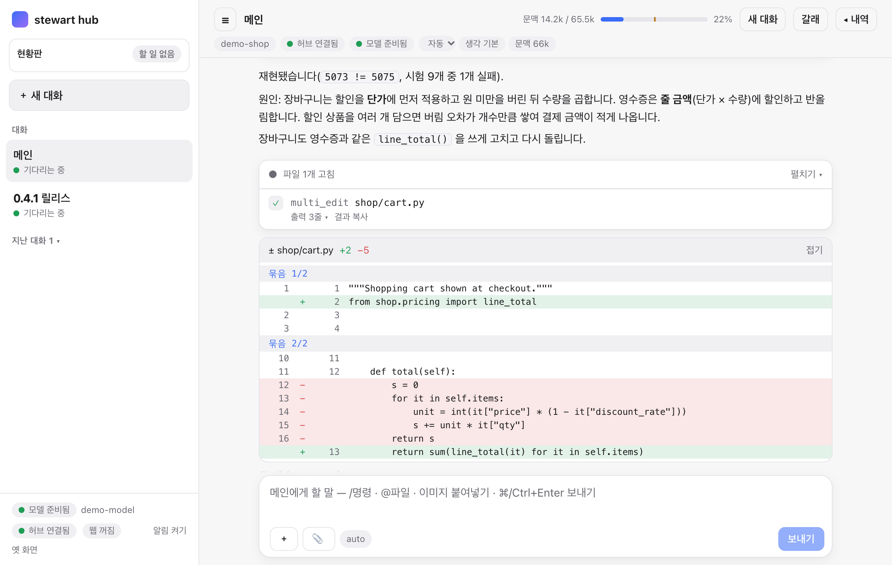
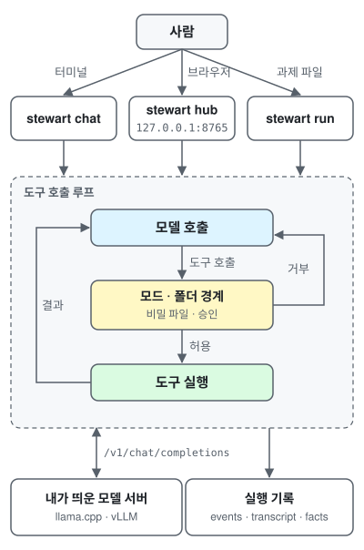

# stewart

[](LICENSE)
[](pyproject.toml)


[](https://github.com/midopa-dept/stewart/actions/workflows/tests.yml)

[Source](https://github.com/midopa-dept/stewart) · [Issues](https://github.com/midopa-dept/stewart/issues) · [stewart-cloud](https://github.com/midopa-dept/stewart-cloud)

**직접 띄운 모델에게 작업 폴더를 맡기는 작은 에이전트 실행기**

A small agent runner that lets a model you host work on a local folder.

한국어 · [English](README.en.md)

## 사용 화면 예


*허브에서 결제 금액 버그를 재현 시험으로 확인하고, 원인을 설명한 뒤 고치는 장면(미리 정한 답을 내는 시연용 모델로 찍음).*

더 보기: [데모 페이지](docs/demo.md) — 허브의 릴리스 준비·사람 손 카드, 터미널 화면과 각 부분 설명.

## Claude Code 와 비교하면

같은 Claude 모델을 붙여 같은 코딩 과제를 풀게 했을 때, stewart 는 Claude Code 보다 회당 비용 0.69–0.77배, 걸린 시간 0.72–0.80배, 과금 토큰 0.25–0.29배를 썼습니다. 성공률은 가를 만한 차이가 없었습니다. 자체 과제 16개로 한 탐색 측정이라 일반 성능으로 읽으면 안 됩니다. 표와 조건·한계는 [아래 비교 절](#같은-모델에서-실행기만-바꿨을-때)에 있습니다.

## 참고 연구와 구현 방향

- **문맥 압축:** 오래된 도구 결과만 가려도 요약만큼 효율적이라는 연구(Complexity Trap)를 따라, 먼저 가리고 모자랄 때만 요약합니다. 요약 꼴은 ACON·Anthropic·OpenHands 의 글을 참고했습니다.
- **기억:** MemGPT·Mem0 의 생각(늘 싣는 핵심과 찾는 보관, 새 사실과 옛 기억의 대조)을 바탕으로 기억을 방침·프로필·자료 세 갈래로 나눴습니다.
- **사람과 나눠 하기:** 단계 세워 묻기, 되짚기, 사람 손 카드는 논문이 아니라 실제로 써 보며 본 실패에서 나왔습니다.
- **지난 일에서 배우기:** 잘 된 꼴을 예시로 두고 비슷한 일에 하나만 붙이며(학습 없이), 표시한 기록은 학습 자료로 내보냅니다([아래 절](#지난-일에서-배우기)).
- 자료마다 무엇이 stewart 의 어디에 들어갔는지(들어감·부분·계획)는 [docs/research-notes.md](docs/research-notes.md) 에 있습니다.

## 목차

- [다른 실행기와 무엇이 다른가](#다른-실행기와-무엇이-다른가)
- [개발 배경](#개발-배경)
- [앞으로의 방향](#앞으로의-방향)
- [어떻게 도나](#어떻게-도나)
- [쓰는 길](#쓰는-길)
  - [대화 자리](#대화-자리)
- [웹 허브](#웹-허브)
- [모델이 쓰는 도구](#모델이-쓰는-도구)
  - [작업자 등급](#작업자-등급)
- [안전 장치](#안전-장치)
- [기억](#기억)
- [지난 일에서 배우기](#지난-일에서-배우기)
- [같은 모델에서 실행기만 바꿨을 때](#같은-모델에서-실행기만-바꿨을-때)
- [설치와 첫 실행](#설치와-첫-실행)
- [설정](#설정)
- [감사와 참고 자료](#감사와-참고-자료)
- [라이선스](#라이선스)

## 다른 실행기와 무엇이 다른가

2026-11-11 각 프로젝트의 공식 문서·저장소로 확인한 기능 차이입니다. 근거 주소는 [docs/research-notes.md](docs/research-notes.md#다른-실행기-비교의-근거) 에 있습니다.

| | stewart | OpenCode | Pi | Claude Code | Codex CLI |
|---|---|---|---|---|---|
| 라이선스 | Apache-2.0 | MIT | MIT | 공개 소스 아님 | Apache-2.0 |
| 모델 | OpenAI 호환 서버 아무것이나, Anthropic API | 여러 공급자, OpenAI 호환 | 여러 공급자, OpenAI 호환 | Claude 모델만 | 여러 공급자, Ollama·LM Studio |
| 화면 | 터미널, 웹 허브(폰 브라우저·알림) | 터미널, 데스크톱(베타), IDE | 터미널, SDK | 터미널, IDE, 데스크톱, 웹, 모바일 | 터미널, IDE, 데스크톱, 웹 |
| MCP | 없음 | 있음 | 있음 | 있음 | 있음 |
| LSP(언어 서버) | 없음 | 내장(기본 끔) | 확인 못 함 | 플러그인 | 확인 못 함 |
| 플러그인·확장 | 없음(스킬·hooks 만) | JS/TS 플러그인 | TS 확장 | 플러그인 마켓 | 플러그인 |
| 스킬(SKILL.md) | 있음 | 있음 | 있음 | 있음 | 있음 |
| 셸 명령의 OS 샌드박스 | 명령마다는 없음. 허브 전체를 macOS 샌드박스에 띄울 수 있음 | 없음 | 없음 | 있음(기본 끔) | 있음(기본 켬) |
| GitHub 별 | 초기 프로젝트 | 226k | 121k | 155k(이슈 저장소) | 135k |

- **stewart 가 맞는 경우:** 직접 띄운 작은 공개 모델이나 함수 호출이 약한 API 로 일을 시킬 때입니다. 실행기 쪽에서 받쳐 주는 장치가 있습니다(먼저 가리고 모자랄 때만 요약하는 압축, 되짚은 결론을 금지로 거는 것, 사람 손 카드, 같은 오류 감지, 웹 확인 넛지, 글 꼴 도구 호출, 깨진 도구 호출 고치기). 브라우저나 폰에서 여러 대화와 작업자를 보며 승인하고 싶을 때, 지시문이 한국어인 편이 나을 때도 맞습니다.
- **다른 실행기가 나은 경우:** MCP 서버·언어 서버·IDE 연동이 필요할 때, 플러그인 생태계와 큰 사용자층·잦은 릴리스가 중요할 때, 셸 명령마다 OS 샌드박스가 기본으로 걸려야 할 때(Codex CLI)입니다. Claude 모델만 쓴다면 Claude Code 가 그 모델에 가장 맞춰져 있습니다.
- 같은 모델로 OpenCode·Pi 와 나란히 잰 비교는 아직 없습니다(계획). 잰 것은 [Claude Code 와의 효율 비교](#같은-모델에서-실행기만-바꿨을-때)뿐입니다.

## 개발 배경

Claude Code 같은 작업 흐름을, 내가 띄운 작은 공개 모델로도 쓰고 싶어 만들었습니다. 기준은 24GB 그래픽 카드에 4비트로 올라가는 급의 모델입니다. 그런 모델은 도구 호출이 깨지거나 같은 시도를 되풀이하고 긴 문맥에서 흔들리기 쉬워서, 실행기 쪽에서 받쳐 주는 장치를 하나씩 더했습니다. 지금은 OpenAI 호환 서버뿐 아니라 Anthropic API 와 여러 API 제공자에도 붙습니다.

장치마다 언제 무엇을 했는지 실행 기록에 남겨, 어느 장치가 실제로 도움이 됐는지 잴 수 있게 했습니다. 재시도·기억·스킬·되짚기 같은 장치는 chat·허브에서만 켜고, `run`(평가 길)은 옛 동작을 그대로 두어 비교가 흔들리지 않게 합니다.

## 앞으로의 방향

- 압축 뒤에도 사람의 금지가 지켜지는지 확인하는 시험
- 공개 벤치마크(Terminal-Bench 등)로 재는 길과, 같은 모델로 다른 실행기와 맞대는 기준선
- 문서 찾기에 선택 사항으로 임베딩 다시 순위

## 어떻게 도나



vLLM·llama.cpp 같은 OpenAI 호환 서버(또는 Anthropic Messages API)에 붙어, 모델이 도구로 파일을 읽고 고치고 셸 명령을 돌리게 합니다. 모델은 들어 있지 않습니다. 서버는 직접 띄우고 stewart 는 거기에 연결합니다.

실행마다 기록이 남아, 모델이 했다고 말한 일과 실제로 바꾼 파일·돌린 명령을 맞대어 볼 수 있습니다. 프롬프트와 도구 메시지는 한국어입니다.

## 쓰는 길

| 명령 | 하는 일 |
|---|---|
| `stewart` | 인자 없이 치면 코드 자리(`stewart chat` 과 같음)로 들어갑니다 |
| `stewart chat` | 터미널에서 대화하며 일을 맡깁니다. 기본 모드는 `edits` 입니다 |
| `stewart parlando` | 대화 자리(`chat -p talk`). 묻고 찾고 정리해 건네는 자리입니다(아래 절) |
| `stewart hub` | 같은 일을 브라우저 화면으로 합니다. 메인 대화 하나에 작업자 세션을 여럿 붙일 수 있습니다 |
| `stewart run` | 과제 하나를 사람 없이 끝까지 돌립니다(`auto` 또는 `--plan`) |

그 밖의 명령: `ping`(서버 확인), `backends`, `profiles`, `rewind`(되돌리기), `dream`(기억 정리), `sessions`(허브의 지난 세션 정리), `hub-user`(허브 계정), `organize`(폴더 정리 계획), `queue`·`bench`(여러 과제 돌리기), `improve`(지난 대화로 배워 두기), `train`(학습 자료 내보내기·teacher 돌리기), `adapter`(LoRA 어댑터 보기). 모두 `stewart <명령> --help` 로 볼 수 있습니다.

### 대화 자리

parlando 는 악보에 적는 말로, '말하듯'이라는 뜻입니다. 이야기하는 자리라 그렇게 부릅니다.

- 프로필 `talk` 는 묻고 찾고 정리해 건네는 자리입니다. 코드 자리(`chat`)와 달리 프로젝트 셸·편집이 없습니다.
  - 자기 대화 폴더(기본 `~/.local/share/stewart/talk`, `--project` 로 바꿈) 안에서만 읽고 씁니다.
  - 도구: 웹 검색·읽기, 받은 파일·그림 보기, 글·파일 만들어 건네기, 기억·문서 찾기, 묻기, 할 일 목록, 울타리 안 계산(`run_code`).
  - 허브 전체를 대화 자리로 켜려면 `stewart hub -p talk` 입니다.
- `run_code`: 계산·표·그래프용 파이썬을 울타리 안에서 돌립니다.
  - 실행마다 대화 폴더의 `.code/<시각-번호>/` 에서 돌고, 쓰기는 그 칸만입니다. 홈·외장 볼륨 읽기, 인터넷, 이 컴퓨터의 앱 열기, 다른 프로그램 실행은 막힙니다.
  - 상한: 30초(`run_code_timeout`, 최대 120), 출력 20,000자, 만든 파일 합 50MB·50개. 만든 그림·CSV 는 "만든 파일" 카드로 건넵니다.
  - macOS 는 `sandbox-exec`, 리눅스는 `bwrap` 이 있을 때만 씁니다. 울타리를 만들 수 없으면 도구를 싣지 않습니다.
  - 다른 꾸러미(matplotlib 등)는 프로필 `code_python` 에 그 꾸러미가 깔린 파이썬 경로를 적습니다. 매번 묻게 하려면 `run_code_ask = true`.

## 웹 허브

```bash
uv run stewart hub --project ~/my-project
```

- `http://127.0.0.1:8765/` 에 뜹니다. 처음 들어갈 때 쓰는 토큰은 허브 폴더의 `hub-token` 에 있고, `stewart hub url` 로 다시 볼 수 있습니다.
- 화면에서 할 수 있는 것
  - 승인 띠: 모델이 묻는 명령을 허용·거부합니다. ⌘/Ctrl+Enter 는 허용, ⇧⌘/Ctrl+Backspace 는 거부입니다.
  - 대화: 파일 고침은 줄 번호가 붙은 diff 카드로, 생각(thinking)은 접히는 블록으로 보입니다. 코드 블록마다 복사 단추가 있습니다.
  - 사람 손 카드: 비밀번호·키체인·sudo·로그인처럼 사람만 풀 수 있는 곳에 닿으면, 모델이 같은 시도를 되풀이하지 않고 사람에게 넘깁니다.
  - 대화 여럿: 메인 대화를 새로 열거나, 지금 대화에서 갈래를 치거나, 닫은 대화를 다시 열 수 있습니다. 승인과 멈춤은 대화마다 따로입니다. `/clear`·`/reset`·`/help` 를 씁니다.
  - 오른쪽 패널: 현황판, 기억, 단계, 계획, 늘 허용 규칙, 토큰, 상태(백엔드·모드·생각·문맥 예산·고정 앞부분 토큰 어림·도구 목록).
  - 지난 대화 찾기: 사이드바의 찾기 칸으로 지난 대화의 사람 말·모델 답을 낱말로 찾아 엽니다.
  - 입력 칸: `/명령`, `@파일`, 이미지 붙여넣기. 큰 폰 사진·HEIC 는 브라우저에서 긴 변 1600px JPEG 로 줄여 붙입니다.
  - 머리줄: 모드(계획·묻기·편집·자동)와 생각(기본·켬·끔)을 바꾸고, 이 대화의 문맥 예산(압축 문턱을 재는 창)을 줄일 수 있습니다. 허브를 켤 때 정한 모드보다 넓히지는 못합니다.
  - 만든·바꾼 파일 카드: 차례가 끝나면 그 차례에 만들거나 바꾼 파일이 [열기]·[받기]로 보입니다. 마크다운은 그려서, 그림·PDF 는 새 탭으로 엽니다. 답 안의 경로 코드를 눌러도 열립니다. 작업 폴더 밖·비밀 꼴 이름은 열지 않고, HTML·SVG 는 받기만 됩니다.
  - 되감기: 사람 말 줄의 ↶ 로 그 차례를 지우고 그 뒤 도구가 바꾼 파일도 되돌립니다. 내 말은 입력 칸으로 돌아옵니다. 파일 카드의 ↶ 는 파일만 되돌립니다. 셸 명령이 바꾼 파일은 되돌리지 못합니다.
  - 파일 올리기와 선택지: 입력 칸의 📎 로 문서·표·PDF 를 작업 폴더 `inbox/` 에 올립니다(20MB 까지, 덮어쓰지 않음). 모델이 선택지를 주며 물으면 질문 아래 단추로 고릅니다.
  - 작업자 띠: 동시 작업자의 상태·걸린 시간·거두지 않은 결과가 대화 위에 보입니다. 메인 차례가 끝난 뒤 작업자가 끝나면 허브가 한 차례를 스스로 열어 결과를 거둡니다(연달아 3번까지, `STEWART_AUTO_WAKE=0` 이면 끔).
  - 모델 서버 상태 점: 준비됨, 올라오는 중, 닿지 않음, 인증 거부.
- 작은 모델용 얇은 메인: backends 표의 등급에 `slim = true` 를 적고 `stewart hub --tier <그 이름>` 으로 켜면, 메인의 고정 앞부분(지시문 + 도구 정의)이 13k 토큰쯤에서 4k 아래로 줄어듭니다.
  - 짧은 지시 하나와 핵심 도구 열 개만 모델에게 보이고, 나머지 도구는 머리줄의 [도구 N ▾] 칩에서 켭니다. 스킬 색인은 이름만 싣습니다.
  - 큰 일은 `workers` 로 작업자에게 맡깁니다. 작업자는 자기 프로필과 등급으로 돌고, `-b` 는 작업자 기본 백엔드로 남습니다(메인은 작은 모델, 작업자는 큰 모델).
  - 줄어든 크기는 `stewart profiles --cost --slim` 으로 잽니다.
- 새 승인 대기는 브라우저 알림으로 알립니다. `[hub] ntfy_url` 을 적으면 [ntfy](https://ntfy.sh) 로 폰에도 보냅니다.
- 듣는 주소는 기본으로 loopback(`127.0.0.1`·`::1`)뿐입니다. 다른 기기에서 쓰려면 앞단(SSH 터널 등)을 두거나 계정 모드를 켭니다.
  - 계정 모드: `[hub]` 에 `accounts = true`, `listen = "<주소>"`, `user_root = "<사람별 작업 폴더의 뿌리>"` 를 적고 `stewart hub-user add <이름>` 으로 사람을 더합니다. 사람마다 세션·대화·승인·작업 폴더가 따로입니다.
  - 비밀번호는 scrypt 로 저장합니다. 세션은 12시간, 쉬면 2시간에 끝납니다.
  - `0.0.0.0` 같은 모든 주소에는 묶지 않습니다. TLS 는 없으니 사설망 안에서만 쓰십시오.

## 모델이 쓰는 도구

| 무리 | 도구 |
|---|---|
| 파일 | `read_file` `list_dir` `search` `glob` `write_file` `edit_file` `multi_edit` `notebook_edit` `view_image`(백엔드 `vision = true` 일 때) |
| 셸 | `run_shell`(상태 유지, 백그라운드 4개까지) `shell_output` `shell_kill` |
| 웹 | `web_search`(SearXNG) `web_fetch` |
| 찾기 | `doc_search`: 작업 폴더의 문서·코드를 BM25 로 찾습니다. 한 번 읽은 웹 글도 함께 찾습니다 |
| 기억 | `memory_search` `memory_read` `note_add` |
| 흐름 | `todo_write` `todo_read` `ask_user` `delegate`(따로 문맥을 쓰는 작업자) `workers`(동시 작업자) `load_skill` |

- `web_fetch` 는 사설·루프백·링크 로컬·CGNAT 주소로 가지 않고, 리다이렉트도 다시 검사합니다. 가져온 글은 바깥 자료 표시로 감싸 모델에게 줍니다.
- chat 과 허브에서는 검색 주소가 없어도 `web_fetch` 와 `doc_search` 가 켜집니다. `run` 은 프로필과 환경 변수에 적은 것만 씁니다.
- 내장 스킬 18개가 chat·허브에서 켜집니다: 단계 계획, 오류 진단, git 작업, 코드 리뷰, 보안 검토, 정리(simplify), 시험 고치기, 실행해 확인, 웹 조사, 깊은 조사, 문서 파일(PDF·Word·Excel·PowerPoint), 프로젝트 안내 파일 만들기, 스킬 만들기, stewart 설정, 인계 문서, 막힘 보고, 기억 정리, 파일로 만들어 건네기. 사용자·프로젝트에 같은 이름의 스킬이 있으면 그쪽이 이깁니다(`STEWART_BUILTIN_SKILLS=0` 이면 끔).
- 스킬 앞머리의 `surfaces: [talk]`·`[code]` 로 그 자리(대화·코드)에서만 색인에 싣고, `tools: [...]` 로 불러올 때 꺼져 있던 도구를 켭니다. 스킬이 권한을 넓히지는 못합니다. 그 자리에 없는 도구는 켜지 못하고, 셸·파일 쓰기처럼 위험한 도구는 켜기 전에 사람에게 묻고, 사람이 끈 도구는 다시 켜지 않습니다(`STEWART_SKILL_TOOLS=0` 이면 끔).
- 동시 작업자(`workers`, chat·허브): 메인이 작업자를 띄우고(spawn) 자기 몫을 계속 하다가 결과를 모읍니다(wait·collect, cancel·list).
  - 작업자는 새 문맥에서 돌고 사람에게 묻지 않습니다. 승인이 필요한 행동은 하지 않고 결과에 적습니다.
  - 동시 상한은 `STEWART_SPAWN_MAX` 이고(없으면 백엔드 concurrency − 1), 끄기는 `STEWART_SPAWN=0` 입니다.
  - 작업자 등급: backends 표의 `[tiers.<이름>]` 로 백엔드·프로필·문맥 예산·동시 상한을 묶습니다. 모델에게는 등급 이름과 한 줄 쓰임새만 보이고, 모델이 고르지 않으면 실행기가 일의 성격(읽기만인지)으로 고릅니다. 기본 예시는 `presto`·`moderato`·`largo` 입니다([작업자 등급](#작업자-등급)).

### 작업자 등급

- 등급은 모델의 크기가 아니라 일을 시키는 방식입니다. 지시문 두께·도구·생각·문맥 예산을 이름 하나로 묶습니다.
- 기본 예시는 넷입니다. 이름은 backends 표 `[tiers.<이름>]` 에서만 정하므로 바꿔도 코드는 그대로입니다. 예시 전문은 `backends.example.toml` 끝에 있습니다.
- 모델이 하나뿐이어도 등급은 그대로 동작합니다. 같은 모델을 다른 두께로 쓸 뿐입니다. 등급에 `backend` 를 적지 않으면 기본 모델을 쓰고, 다른 모델이 있으면 `backend` 한 줄을 더합니다.
- 작업자를 동시에 몇이나 돌릴지는 모델 서버의 동시 요청 설정(백엔드 `concurrency`)이 정합니다. 등급의 `max` 로 더 줄일 수 있습니다.
- 등급의 서버에 닿지 못하면 기본 모델로 대신 돌리지 않습니다. 작업자는 그 사실을 적고 끝나고, `--tier` 로 켜면 시작할 때 알립니다. 표에 없는 등급은 거절하고 있는 등급을 보여 줍니다.
- 생각 칸: `think`, `think_max_tokens`·`think_max_tokens_first`, `reasoning_effort`·`reasoning_effort_at`, `think_sampling`. 같은 것을 `STEWART_THINK_*`·`STEWART_REASONING_*` 환경 변수로도 줍니다. 환경 변수가 등급보다, 등급이 프로필보다 앞섭니다.
- 등급의 문맥 예산은 그 등급의 메인(`--tier`)과 작업자 모두의 압축 창입니다. 등급 없이 도는 실행은 예전 그대로입니다.
- 꼬리표는 "자리 · 등급"으로 읽습니다(작업자 3 · `presto` / 메인 · `largo`).

| 등급 | 하는 일 |
|---|---|
| `presto` | 찾기·읽기·요약처럼 가벼운 일. 얇은 지시문·읽기 도구·짧은 문맥이라 작업자로 여럿 띄우기 좋습니다. `slim = true` 라 메인으로 앉히면 얇은 허브입니다. 결과는 검산합니다 |
| `moderato` | 코딩·대화의 기본. 도구를 적은(쓰는) 작업의 기본 등급입니다 |
| `largo` | 계획·분배·검토. 모든 도구와 넓은 문맥을 쓰는 메인으로 앉힙니다(`stewart hub --tier largo`) |
| `rubato` | 바깥 API(유료). 등급 표에 두지 않고, 따로 띄운 인스턴스(`stewart instance`)로 사람이 열 때만 씁니다. 기본 모델로 대신하는 일은 없습니다 |

## 안전 장치

stewart 는 모델이 고른 셸 명령을 내 기기에서 돌립니다. 아래 장치는 실수를 줄일 뿐 격리가 아닙니다. 처음 보는 저장소나 무인 실행은 컨테이너·가상 기계·전용 계정에서 돌리십시오.

- **모드:** `auto`(바로 실행), `edits`(파일 고침은 바로, 셸은 묻기), `ask`(읽기 말고 모두 묻기), `plan`(읽기만).
- **작업 폴더 경계:** 경로를 realpath 로 풀고 위쪽 폴더를 inode 로 맞대어 봅니다. 링크로 밖에 나가도 잡힙니다. 폴더 밖 쓰기는 `run` 에서 거부하고 chat·허브에서는 모드와 상관없이 묻습니다. 프로필의 `extra_write_dirs` 와 `read_outside`(allow·ask·deny)로 조정합니다.
- **셸 검사의 한계:** 셸 명령은 흔한 쓰기 꼴(리다이렉트, `rm`·`mv`·`cp`·`sed -i` 등)만 봅니다. 변수·치환이 든 경로, `python -c` 같은 다른 프로그램 안의 쓰기, `bash -c`·`eval` 은 보지 못합니다.
- **비밀 파일:** `.env`, 키, 인증서, `.netrc` 같은 파일은 도구가 읽지도 쓰지도 않습니다. 셸로 읽으려 해도 막습니다. 견본(`.env.example`)은 됩니다.
- **설정 폴더:** `~/.config/stewart` 와 허브 폴더에 쓰려 하면 chat 은 늘 묻고 `run` 은 거부합니다.
- **셸 환경:** 모델의 셸에는 stewart 의 가상 환경, `STEWART_*` 변수, 설치 경로가 든 변수가 넘어가지 않습니다. API 키는 백엔드 파일에 적은 이름의 환경 변수에서 읽습니다.
- **hooks:** `SessionStart`·`PreToolUse`·`PostToolUse`·`Stop`. 표준 입력으로 JSON 을 받고 종료 코드 2 면 그 동작을 막습니다. 사용자 프로필에서만 읽습니다.
- **되짚기:** 같은 오류가 세 번 나거나 같은 호출이 되풀이되면 모델에게 알리고, 계속되면 멈춥니다.
- **이 컴퓨터의 화면·앱은 기본으로 열지 않습니다:** 셸 명령이 이 컴퓨터의 앱·브라우저·창을 열거나 조작하면(macOS `open`·`osascript`·`screencapture`, 리눅스 `xdg-open`·`xdotool`, Windows `start`·`Start-Process`, 파이썬 `webbrowser` 등) 실행하지 않고 까닭을 돌려주며, 모델은 그 사실을 사람에게 말합니다.
  - 셸 실행 자리에서 막으므로 auto 모드나 "늘 허용" 규칙으로도 지나가지 않습니다.
  - 켜려면 프로필에 `host_gui = true`(또는 `STEWART_HOST_GUI=1`)를 둡니다. 켜도 대화(chat·허브)에서 명령마다 묻고, 승인한 그 명령 한 번만 실행합니다.
  - 사람에게 묻지 못하는 작업자와 `stewart run` 은 켜져 있어도 늘 거절합니다.

## 기억

- chat 과 허브에서는 기본으로 켜지고, `run`·`bench` 에서는 꺼집니다. `STEWART_MEMORY=0|1` 이나 프로필 `memory` 가 이깁니다.
- 기억은 세 갈래로 나눠 사람이 열어 고칠 수 있는 마크다운에 둡니다. 범위는 모든 프로젝트와 이 프로젝트 둘입니다.
  - 방침(`policy.md`): "앞으로 …", "… 하지 마라" 처럼 오래 지킬 지시. 지시문에 늘 싣습니다.
  - 프로필(`profile.md`): 언어·역할·선호 같은 짧은 사실. 작은 상한 안에서 늘 싣습니다.
  - 자료(`knowledge/`): 모델이 몰랐거나 틀려서 사람이 고쳐 준 사실. 지시문에 싣지 않고 `doc_search` 로 찾습니다.
- "앞으로" 가 붙은 지시는 방침으로 남길지 묻고, 이번 차례에만 해당하는 지시는 남기지 않습니다. 허브의 기억 탭에서 보고, 고치고, 지울 수 있습니다.
- 메모는 `stewart dream` 이 대상마다 `MEMORY.md` 제안으로 모읍니다. 사람이 `--accept` 로 들이기 전에는 바뀌지 않습니다. 허브는 한가할 때 제안을 스스로 만듭니다(`STEWART_DREAM_AUTO=0` 이면 끔).
- 기억 정리: 허브에서 `/memory` 또는 "기억 정리해 줘", 터미널에서 `stewart memory consolidate`. 모델이 세 갈래를 한 번 읽고 갈래 옮기기·합치기·지움 후보·짧게 다시 쓰기를 제안하고, 사람이 항목마다 받거나 둡니다. 받기 전에 사본을 남기고 `--revert` 로 되돌립니다(`--dry-run` 은 제안만).
- 손으로 쓴 규칙 파일(`AGENTS.md`, `STEWART.md`)과 부딪히면 규칙 파일이 이깁니다.
- 기억 폴더는 `~/.local/share/stewart/memory`(`STEWART_MEMORY_DIR`)입니다.

## 지난 일에서 배우기

학습 없이 지난 대화에서 배우는 길과, 학습 자료로 내보내는 길이 있습니다. 어느 쪽이든 사람이 고르고 받은 것만 남습니다.

- **표시:** 허브의 답 줄에서 👍·👎 를 누르거나, chat 에서 `/good`·`/bad` 를 칩니다. 다음 말이 고쳐 달라는 꼴이면 앞 차례에 "교정됨" 꼬리표가 붙습니다(눌러 뗄 수 있음).
- **예시 은행:** 잘 된 꼴을 `examples.md`(기억 폴더)에 둡니다. 차례가 시작될 때 사람 말과 낱말이 가장 많이 겹치는 예시 **하나만** 사람 말 끝에 붙입니다. 지시문은 그대로라 프롬프트 캐시가 깨지지 않습니다. 끄기: `STEWART_EXAMPLES=0`.
- **배워 두기:** 허브에서 `/improve` 또는 "지난 대화로 배워 둬", 터미널에서 `stewart improve` 를 씁니다.
  - 👍·교정된 차례를 모아 모델이 한 번 읽고 예시·방침·스킬 초안을 제안합니다.
  - 코드가 근거 차례가 실제로 있는지, 비밀·길이·겹침을 다시 보고, 사람이 항목마다 받거나 둡니다.
  - 스킬 초안은 따로 두고, 사람이 옮겨야 켜집니다.
  - 받기 전에 사본을 남기고 `--revert` 로 되돌립니다. `--stats` 는 예시가 붙은 차례와 안 붙은 차례의 👍·교정 비율을 보입니다.
  - 바깥 API 백엔드면 고른 차례의 글이 그 회사로 나가므로 먼저 묻습니다.
- **학습 자료로 내보내기:** `stewart train export` 는 표시한 차례를 OpenAI chat 꼴 JSONL 로 씁니다.
  - 비밀·홈 경로·사용자 이름은 가리고, 엔진 넛지와 실패한 호출은 뺍니다.
  - 자료의 출처별 약관 등급 표로 기본으로 거릅니다.
  - `stewart train teacher` 는 시험 명령이 붙은 과제 풀을 다른 백엔드로 돌려, 시험을 통과한 기록만 후보로 남깁니다. 비용·회차 상한이 있습니다.
  - 학습·판정은 별도 도구 [stewart-tune](https://github.com/midopa-dept/stewart-tune) 이 맡습니다.
- **LoRA 어댑터 고르기:** backends 표의 `adapters`·`adapter` 로 서버에 올린 어댑터를 고릅니다(vLLM 은 model 칸, llama.cpp 는 lora 칸).
  - `STEWART_ADAPTER=off` 한 줄로 기반 모델로 돌아갑니다.
  - `stewart adapter` 로 서버에 실렸는지 대조합니다.

## 같은 모델에서 실행기만 바꿨을 때

같은 Claude 모델을 stewart 와 Claude Code(2.1.311)에 각각 붙여 같은 코딩 과제를 풀게 하고, 쓴 비용·시간·토큰을 비교했습니다. 사전 등록한 연구 밖에서 한 탐색 측정입니다.

| 모델 | stewart | 벽시계 비 | 회당 비용 비 | 과금 토큰 비 |
|---|---|---|---|---|
| `claude-sonnet-5-5` | 개발 판 72 | 0.80 [0.71, 0.91] | 0.73 [0.62, 0.83] | 0.29 [0.24, 0.34] |
| `claude-sonnet-5-5` | 개발 판 10 + Anthropic 백엔드 | 0.77 [0.71, 0.84] | 0.69 [0.57, 0.80] | 0.26 [0.22, 0.30] |
| `claude-opus-5-5` | 개발 판 72 | 0.72 [0.65, 0.78] | 0.77 [0.64, 0.90] | 0.25 [0.20, 0.29] |
| `claude-opus-5-5` | 개발 판 10 + Anthropic 백엔드 | 0.72 [0.67, 0.77] | 0.76 [0.64, 0.89] | 0.25 [0.20, 0.30] |

- 비 = stewart ÷ Claude Code(과제별 평균의 비). 1 보다 작으면 stewart 쪽이 적게 썼습니다. 괄호는 과제 단위 붓스트랩 95% 구간입니다.
- 회당 중앙값: Sonnet 은 stewart 15–17초·$0.05–0.06, Claude Code 20초·$0.08. Opus 는 stewart 22초·$0.09–0.10, Claude Code 29초·$0.14.
- 과금 토큰 차이는 대부분 매 요청에 실리는 시스템 지시·도구 정의의 크기 차이로 봅니다.
- 성공률(숨긴 시험 통과 + 지시 준수)은 두 실행기 사이에 가를 만한 차이가 없어 싣지 않았습니다.

조건
- 과제: 공개 전 자체 과제 16개(v2 개발 묶음의 일부). 따로 떼어 둔 평가용(보류) 묶음은 쓰지 않았습니다. 과제마다 stewart 1–2회, Claude Code 5–22회.
- 측정일: stewart 2026-11-11, Claude Code 2026-11-10. 같은 평가기·같은 과제·같은 채점 코드.
- stewart: 생각 adaptive(노력 기본값), `code` 프로필, 웹 끔, 프롬프트 캐시 켬. Claude Code: 제품 기본 설정, acceptEdits, 평가 규칙 한 줄만 덧붙임, 자동 기억 끔.
- 비용: 두 실행기 모두 API 가 보고한 토큰(입력·출력·캐시 읽기·캐시 쓰기)에 같은 공식 단가표를 곱했습니다.

한계
- 과제·평가기·숨긴 시험은 아직 비공개입니다(연구와 함께 공개 예정). 지금은 다른 사람이 다시 돌려 볼 수 없습니다.
- Claude Code 쪽은 하루 앞서 쟀습니다. API 지연은 날·시각에 따라 달라 벽시계 비교에는 그 몫이 섞입니다. 비용·토큰 비교는 날과 무관합니다.
- 과제 16개는 모델·실행기 사이 성공률 차이를 보려고 고른 묶음이고, 무작위 표본이 아닙니다. 효율 비가 다른 과제에서도 같을지는 모릅니다.
- 두 실행기의 생각 설정은 각자의 기본값입니다. 같은 설정이라고 보장하지 않습니다.
- Claude Code 가 스스로 보고한 비용은 같은 토큰을 단가표로 센 값보다 컸습니다(Opus 1.47배). 이 표는 단가표 셈이며, 실제 청구 비교가 아닙니다.
- 한 사람이 맥 한 대에서 잰 것입니다.

## 설치와 첫 실행

[uv](https://docs.astral.sh/uv/) 와 git 이 필요합니다. [ripgrep](https://github.com/BurntSushi/ripgrep) 이 있으면 `search` 가 빨라집니다.

```bash
git clone https://github.com/midopa-dept/stewart.git
cd stewart
uv sync
mkdir -p ~/.config/stewart
cp backends.example.toml ~/.config/stewart/backends.toml
```

[llama.cpp](https://github.com/ggml-org/llama.cpp) 의 `llama-server` 로 도구 호출이 되는 모델을 띄웁니다.

```bash
llama-server -m <model.gguf> --port 8080 --ctx-size 16384 --jinja
```

`backends.toml` 의 `[backends.local]` 이 `http://127.0.0.1:8080/v1` 을 가리킵니다. `model` 을 서버가 알려 주는 이름으로 바꾸고 해 봅니다.

```bash
uv run stewart ping -b local
uv run stewart chat --backend local --workdir ~/my-project
uv run stewart hub --project ~/my-project
uv run stewart run -p code --backend local --workdir ~/my-project --task "실패하는 시험을 고쳐 주세요"
```

### Anthropic API

```bash
uv sync --extra anthropic
export ANTHROPIC_API_KEY=...   # 키는 환경 변수에만 둡니다
```

`backends.toml` 에 `kind = "anthropic"` 백엔드를 더합니다. 예시는 `backends.example.toml` 끝에 있습니다. 키 변수는 모델의 셸 환경에 넘어가지 않습니다.

### 다른 API

`backends.providers.example.toml` 에 EXAONE·OpenAI·Gemini·OpenRouter 같은 제공자 예시가 있습니다. 복사해 쓸 항목만 켜고 `STEWART_BACKENDS=<복사한 파일>` 로 씁니다.

- 키는 `api_key_env`(환경 변수 이름)나 macOS 키체인 항목 이름(`api_key_keychain`)으로 줍니다. 어느 쪽이든 키 값은 모델의 셸에 넘어가지 않습니다.
- 함수 호출 칸이 없는 API 는 `tool_mode = "text"` 로 글 꼴 도구 호출을 씁니다.
- `provider` 를 적으면 허브 화면에 작업 내용이 바깥 회사로 나간다는 표시가 붙습니다. 약관과 가격은 제공자 문서에서 확인하십시오.
- 바깥 API 로 도는 허브를 따로 띄우려면 `stewart instance <이름> start` 를 씁니다. 설정·상태·기억 폴더가 `stewart-<이름>` 으로 갈리고, macOS 샌드박스 안에서 돌며 그 안에서는 키체인 조회를 막습니다.

### 빌린 GPU

더 큰 모델은 빌린 GPU 에서 [stewart-cloud](https://github.com/midopa-dept/stewart-cloud) 로 띄울 수 있습니다. vLLM 을 직접 쓴다면 `--enable-auto-tool-choice --tool-call-parser <모델에 맞는 파서>` 를 켜고, 포트는 인터넷에 열지 말고 SSH 터널이나 사설망으로만 닿게 둡니다.

### Windows

설치와 실행은 같습니다(`uv sync`, `uv run stewart`). 다만 `run_shell` 이 쓸 셸이 있어야 합니다. 아래 가운데 하나를 둡니다.

- [busybox-w32](https://frippery.org/busybox/) 를 받아 저장소의 `bin\busybox64u.exe` 로 둡니다.
- 환경 변수 `STEWART_SHELL` 에 셸 실행 파일을 적습니다.
- `~/.config/stewart/config.toml` 의 `[shell] path` 에 적습니다.

Git bash 도 쓸 수 있지만 `/c/…` 꼴 경로 때문에 폴더 경계 판정이 아직 맞지 않아 경고가 뜹니다.

## 설정

| 무엇 | 어디 |
|---|---|
| 백엔드 | `STEWART_BACKENDS` → `~/.config/stewart/backends.toml` → 저장소의 `backends.toml` |
| 허브 | `~/.config/stewart/hub.toml`(`STEWART_HUB_CONFIG`). `[hub]`(포트·알림·계정), `[web]`(검색 주소) |
| 내 프로필 | `~/.config/stewart/profiles/`. `extends = "code"` 로 물려받고 바꿀 것만 적습니다 |
| 프로젝트 지시 | `AGENTS.md`, `STEWART.md`, `~/.config/stewart/STEWART.md` |
| 실행 기록 | `~/.local/state/stewart/runs/` |

```toml
# ~/.config/stewart/backends.toml
default = "local"

[backends.local]
base_url = "http://127.0.0.1:8080/v1"
model = "local-model"
max_context = 16384          # vLLM 이면 시작할 때 max_model_len 으로 다시 읽습니다
timeout_s = 600
# api_key_env = "MY_KEY_ENV"  # 키를 담은 환경 변수 이름. 키 자체는 적지 않습니다

[backends.local.params]       # 모든 요청 본문에 합쳐집니다
temperature = 0.2
```

```toml
# ~/.config/stewart/hub.toml
[web]
url = "<SearXNG 주소>"   # SearXNG(JSON 출력을 켠 것). backend = "none" 이면 웹 도구를 끕니다
```

- 생각(thinking): chat 의 `--think`·`/think`, `STEWART_THINK_MAX_TOKENS`, `STEWART_THINK_SAMPLING`.
- 끝내기 전 확인: 프로필 `check_on_stop`(`code` 프로필은 켜짐).
- 시험: `uv run python -m unittest discover -s tests -t .`. 가짜 서버로만 돌고 망이 필요 없습니다.

### 내장 프로필

| 이름 | 쓰임 |
|---|---|
| `chat` | 대화형 코딩. 모든 도구 |
| `code` | 코드를 고치고 시험을 돌려 확인 |
| `manager` · `worker` · `verifier` | 일을 쪼개 작업자에게 맡기고 검증자가 판정 |
| `research` | 웹에서 찾아 출처를 달아 정리 |
| `organize` | 폴더를 훑어 옮길 계획만 만듦 |
| `media` | 분류가 안 된 미디어 파일의 자리 제안 |

## 감사와 참고 자료

- 연구 자료와 stewart 구현의 대응: [docs/research-notes.md](docs/research-notes.md)
- 웹 화면(`ui/`)의 일부는 MIT 라이선스 프로젝트 [llama.cpp](https://github.com/ggml-org/llama.cpp)·[opencode](https://github.com/anomalyco/opencode)·[OpenHands](https://github.com/OpenHands/OpenHands) 에서 꼴과 코드를 빌려 왔습니다. 부품과 라이선스 전문은 [ui/THIRD_PARTY.md](ui/THIRD_PARTY.md), 묶은 꾸러미는 [NOTICE](NOTICE) 에 있습니다.
- Anthropic [Claude Code](https://docs.anthropic.com/en/docs/claude-code) 문서: 실행 모드, hooks, 할 일, 기억 파일, 하위 에이전트의 꼴
- Anthropic, "The components of agent memory": 기억의 층(기록, 메모, 쪽, 주입 색인)
- Qwen3 모델 카드: 생각 모드 권장 샘플링 값(`STEWART_THINK_SAMPLING=qwen`)
- [vLLM](https://github.com/vllm-project/vllm), [SearXNG](https://github.com/searxng/searxng), [uv](https://github.com/astral-sh/uv), [ntfy](https://ntfy.sh), [busybox-w32](https://frippery.org/busybox/)

## 라이선스

Apache License 2.0. [LICENSE](LICENSE) 와 [NOTICE](NOTICE) 를 보십시오.
