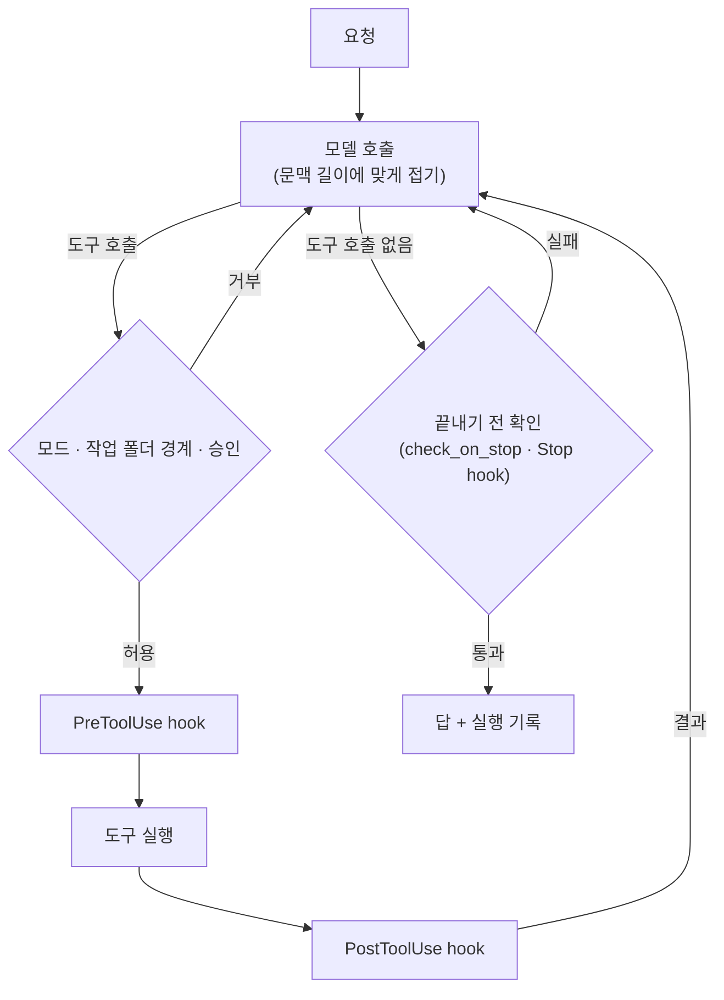

# stewart

[](LICENSE)
[](pyproject.toml)


[](https://github.com/midopa-dept/stewart/actions/workflows/tests.yml)

[Source](https://github.com/midopa-dept/stewart) · [Issues](https://github.com/midopa-dept/stewart/issues)

**직접 띄운 모델에게 작업 폴더를 맡기는 작은 에이전트 실행기**

A small agent runner that lets a model you host work on a local folder.

Python · OpenAI 호환 API · llama.cpp / vLLM · macOS / Linux

한국어 · [English](README.en.md) · [stewart-cloud](https://github.com/midopa-dept/stewart-cloud)



stewart는 vLLM·llama.cpp 같은 OpenAI 호환 채팅 완성 서버에 붙어 도는 작은 에이전트 실행기입니다.

직접 띄운 모델과 작업 폴더 하나를 주면, 모델이 도구로 일을 합니다. 파일을 읽고 고치고, 셸 명령을 돌리고, 웹을 검색하거나 가져옵니다.
실행마다 전체 기록이 남으므로, 모델이 했다고 말한 일과 실제로 한 일을 맞대어 볼 수 있습니다.

프롬프트, 도구 메시지, 명령 도움말은 한국어입니다.

## 무엇인가

- `/v1/chat/completions` 위에서 도는 도구 호출 루프입니다. Python 3.12로 썼고, 실행 의존성은 prompt_toolkit·rich 두 개입니다.
- 쓰는 방법은 두 가지입니다.
  - `stewart run`: 과제 하나를 사람 없이 끝까지 실행합니다.
  - `stewart chat`: 입력창이 고정된 대화형 세션입니다.
- 모델은 들어 있지 않습니다. 서버는 직접 띄우고, stewart가 거기에 연결합니다.

## 기능

- 실행 모드
  - `auto`: 도구를 바로 실행합니다.
  - `edits`: 파일 편집은 바로 하고, 셸 명령은 먼저 묻습니다.
  - `ask`: 읽기 말고는 모두 묻습니다.
  - `plan`: 읽기만 하고 계획을 씁니다.
- 체크포인트와 되돌리기: `/undo`, `/rewind`, `stewart rewind`. 끝내지 못한 무인 실행은 자동으로 되돌릴 수 있습니다(프로필 설정).
- 작업 폴더 경계, 비밀 파일 보호, 걸러 낸 셸 환경([안전 모델](#안전-모델) 참고)
- 문맥 처리
  - 서버의 `max_model_len`을 읽어, 그 길이에 맞게 대화를 줄입니다.
  - 문맥이 넘치면 한 번 접고 다시 보냅니다.
  - 생각(thinking)만 하다 길이 상한에 닿아 빈 답이 나온 차례는, 생각을 끄고 한 번 다시 보냅니다.
- 프로필(TOML)로 도구·지시문·상한을 정합니다. 내장 프로필로 `code`, `chat`, `research`, `organize`, `media` 등이 있습니다.
- 되묻기 도구 `ask_user`, 따로 문맥을 쓰는 하위 작업자 `delegate`, 스킬, 최소한의 hooks
- 끝내기 전에 켤 수 있는 자기 점검
  - 확인 명령
  - 요구 사항 대조
  - 물어봤어야 했는지 판단
  - 회귀 기준선
  - 할 일 확인
- 선택 기능인 기억: 실행 색인, 메모, 대상별 쪽, 주입 색인. 정리는 사람이 직접 부르는 `stewart dream`이 맡습니다.
- 실행 기록: `events.jsonl`, `transcript.md`, `summary.json`, `facts.md`

## 바로 해 보기

### 1. 설치

macOS 또는 Linux, [uv](https://docs.astral.sh/uv/), git이 필요합니다. [ripgrep](https://github.com/BurntSushi/ripgrep)이 있으면 검색이 빨라집니다.

```bash
git clone https://github.com/midopa-dept/stewart.git
cd stewart
uv sync
uv run stewart --help
```

예시 백엔드 파일을 복사해 고칩니다.

```bash
mkdir -p ~/.config/stewart
cp backends.example.toml ~/.config/stewart/backends.toml
```

### 2. 내 컴퓨터의 모델로 해 보기

[llama.cpp](https://github.com/ggml-org/llama.cpp)의 `llama-server`로, 도구 호출을 지원하는 작은 instruct 모델을 띄웁니다.

```bash
llama-server -m <model.gguf> --port 8080 --ctx-size 16384 --jinja
```

`~/.config/stewart/backends.toml`의 `[backends.local]`은 `http://127.0.0.1:8080/v1`을 가리킵니다. `model`은 서버가 알려 주는 이름으로 바꾸고, 다음을 실행합니다.

```bash
uv run stewart ping -b local
uv run stewart chat -b local --workdir ~/my-project
```

### 3. GPU를 빌려 쓰기

빌린 GPU에서 더 큰 모델을 인터넷에 내놓지 않고 돌리려면 [stewart-cloud](https://github.com/midopa-dept/stewart-cloud)를 쓰십시오.

서버를 직접 띄워도 됩니다. 도구 호출을 지원하는 OpenAI 호환 주소라면 stewart가 연결할 수 있습니다. vLLM이라면 모델 계열에 맞는 도구 호출 파서를 켭니다.

```bash
vllm serve <model> --served-model-name my-model \
  --host 127.0.0.1 --port 8000 --max-model-len 65536 \
  --enable-auto-tool-choice --tool-call-parser <parser>
```

포트는 공개하지 마십시오. SSH 터널이나 사설망으로 닿게 하고, 아래처럼 백엔드로 등록합니다.

## 설정

stewart는 백엔드 파일을 이 차례로 찾습니다.

1. `STEWART_BACKENDS`(파일 경로)
2. `~/.config/stewart/backends.toml`
3. 저장소 뿌리의 `backends.toml`

```toml
[backends.cloud]
base_url = "http://127.0.0.1:8000/v1"
model = "my-model"                      # --served-model-name 과 같게
max_context = 65536                     # 시작할 때 서버의 max_model_len 으로 바뀝니다
concurrency = 8
api_key_env = "STEWART_CLOUD_API_KEY"   # 키를 담은 환경 변수 이름. 키 자체는 적지 않습니다
timeout_s = 240

[backends.cloud.params]                 # 모든 요청 본문에 합쳐집니다
temperature = 0.2
max_tokens = 8192
```

자주 쓰는 명령은 다음과 같습니다.

```bash
uv run stewart ping -b cloud
uv run stewart chat -b cloud --workdir ~/my-project
uv run stewart run -p code -b cloud --workdir ~/my-project --task "실패하는 시험을 고쳐 주세요"
uv run stewart run -p code -b cloud --workdir ~/my-project --plan --task "..."
uv run stewart profiles
```

- 프로필
  - 내장 프로필은 `profiles/`에 있습니다.
  - 내 프로필은 `~/.config/stewart/profiles/`에 둡니다.
  - `extends = "code"`로 물려받고 바꿀 항목만 적습니다.
- 실행 기록은 `~/.local/state/stewart/runs/<시각>-<프로필>/`에 남습니다.
- 웹 검색
  - `STEWART_SEARXNG_URL`에 적은 [SearXNG](https://github.com/searxng/searxng) JSON 주소를 씁니다.
  - `web_fetch`는 사설 주소를 막습니다.
- 생각(thinking)
  - `--think`나 `/think`로 켜고 끕니다.
  - `STEWART_THINK_MAX_TOKENS`, `STEWART_THINK_SAMPLING`으로 조절합니다.
- 자기 점검: `STEWART_CHECK_ON_STOP`(`code` 프로필은 켜져 있습니다), `STEWART_REVIEW_ON_STOP`, `STEWART_ASK_CHECK`, `STEWART_BASELINE_DIFF`, `STEWART_TODO_CHECK`. 나머지는 기본으로 꺼져 있습니다.
- 기억: 기본으로 꺼져 있습니다. 프로필의 `memory = true`나 `STEWART_MEMORY=1`로 켭니다.
- hooks
  - 프로필의 `[hooks]` 표에 적습니다: `SessionStart`, `PreToolUse`, `PostToolUse`, `Stop`.
  - hook은 표준 입력으로 JSON을 받고, 종료 코드 2를 돌려주면 그 동작을 막습니다.
- 시험: `uv run python -m unittest discover -s tests -t .`는 가짜 서버로만 돌고 망이 필요 없습니다.

## 안전 모델

stewart는 모델이 셸 명령을 실행하게 합니다. 아래 장치는 실수를 줄이지만 격리는 아닙니다. 중요한 자료가 없는 기기에서 쓰거나, 운영체제 샌드박스·전용 계정·컨테이너 안에서 쓰십시오.

- **작업 폴더 경계**
  - 경로를 realpath로 풀고 상위 폴더를 inode로 확인하므로, 심볼릭 링크로 폴더 밖에 나갈 수 없습니다.
  - 폴더 밖 쓰기는 `run`에서는 거부하고, `chat`에서는 묻습니다. 승인은 그 경로에만 적용됩니다.
  - `extra_write_dirs`와 `read_outside`(allow, ask, deny)로 경계를 넓히거나 좁힙니다.
  - 셸 명령은 흔한 쓰기 꼴만 검사합니다.
- **비밀 파일:** `.env`, 키, 인증서처럼 보이는 파일은 도구가 읽지도 쓰지도 않습니다(프로필 `[secret_files]`). stewart 자신의 설정 폴더도 보호합니다.
- **걸러 낸 환경**
  - 모델의 셸에는 stewart의 가상 환경과 그 `PATH` 항목, `STEWART_*` 변수, stewart 설치 경로가 든 변수가 보이지 않습니다.
  - API 키는 백엔드 파일에 적힌 이름의 환경 변수에서 읽고, 파일에는 변수 이름만 적습니다.
- **승인:** 무엇을 묻지 않고 실행할지는 모드가 정합니다. 폴더 밖 쓰기와 stewart 설정 고치기는 모든 모드에서 묻고, 이때 빈 답은 거부로 봅니다.
- **기록:** Brave 검색 엔진의 결과는 실행 기록에 남기지 않습니다. 예전 기록에서는 `python -m stewart.scrub_records`로 지웁니다(기본은 미리 보기만 합니다).

## 다른 점

stewart는 직접 띄운 모델을 위한, 들여다보기 쉬운 작은 실행기입니다. 범용 에이전트 프레임워크가 아닙니다.

- 직접 띄운 모델을 전제로 서버의 문맥 길이와 도구 호출 버릇에 맞춥니다. 깨진 도구 호출은 다시 묻고, 같은 호출의 되풀이를 알아채고, 생각만 하다 빈 답이 된 차례를 다룹니다.
- 기록을 먼저 생각했습니다. 실행마다 남는 내용으로, 모델의 최종 답을 실제로 바뀐 파일과 실행한 명령에 맞대어 볼 수 있습니다.
- 자기 점검과 기억은 따로 켜는 스위치이고 기본으로 꺼져 있습니다. 하나씩 켜 보며 무엇이 달라지는지 볼 수 있습니다.

## 감사와 참고 자료

아래 프로젝트에서 가져온 코드는 없습니다. 바깥 꾸러미는 [NOTICE](NOTICE)에 있습니다.

- Anthropic, [Claude Code](https://docs.anthropic.com/en/docs/claude-code) 문서: 실행 모드, hooks, 할 일 목록, 기억 파일, 하위 에이전트의 꼴
- Anthropic, "The components of agent memory": 기억의 층(기록, 메모, 쪽, 주입 색인)과, 작은 주입층에 대상마다 한 쪽을 두는 방식
- Qwen3 모델 카드: 생각 모드 권장 샘플링 값(`STEWART_THINK_SAMPLING=qwen`)
- [vLLM](https://github.com/vllm-project/vllm), [llama.cpp](https://github.com/ggml-org/llama.cpp), [SearXNG](https://github.com/searxng/searxng), [uv](https://github.com/astral-sh/uv)
- OpenAI Chat Completions API의 도구 호출 꼴

## 라이선스

Apache License 2.0입니다. [LICENSE](LICENSE)와 [NOTICE](NOTICE)를 보십시오.
