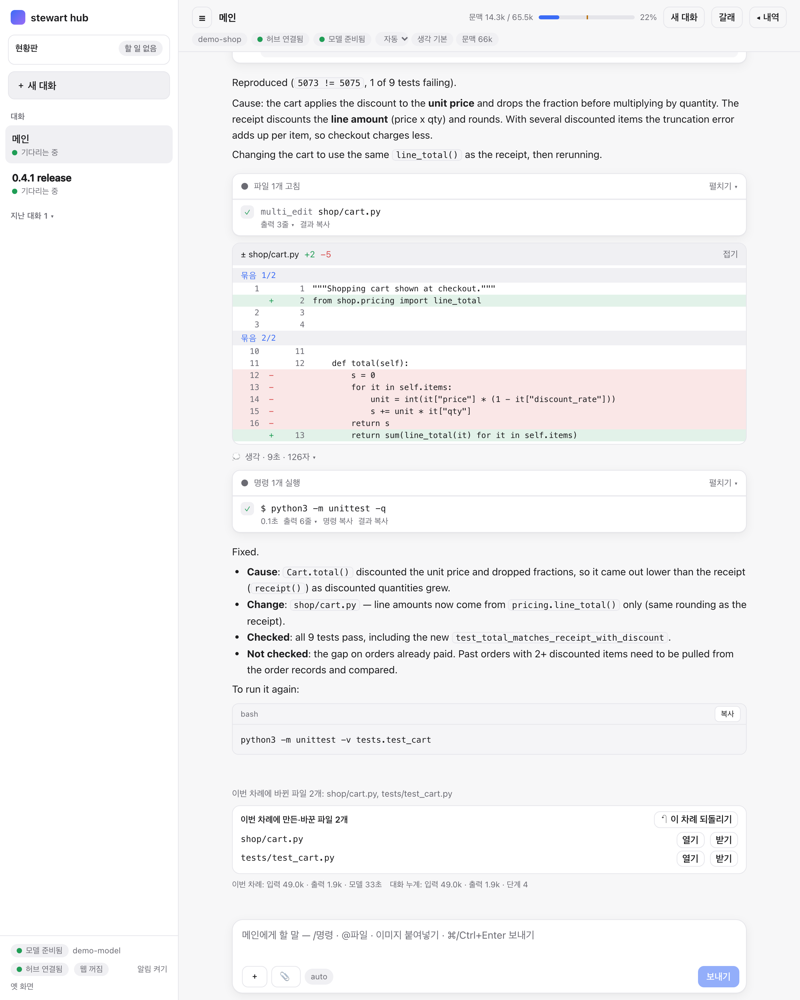
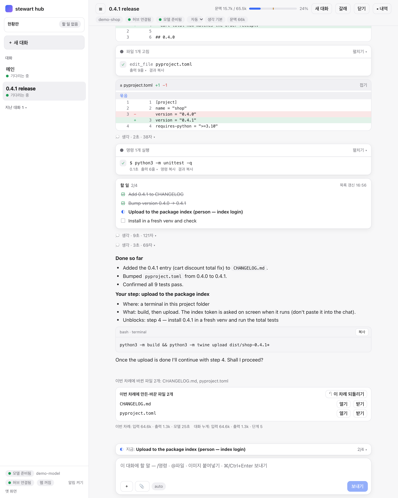
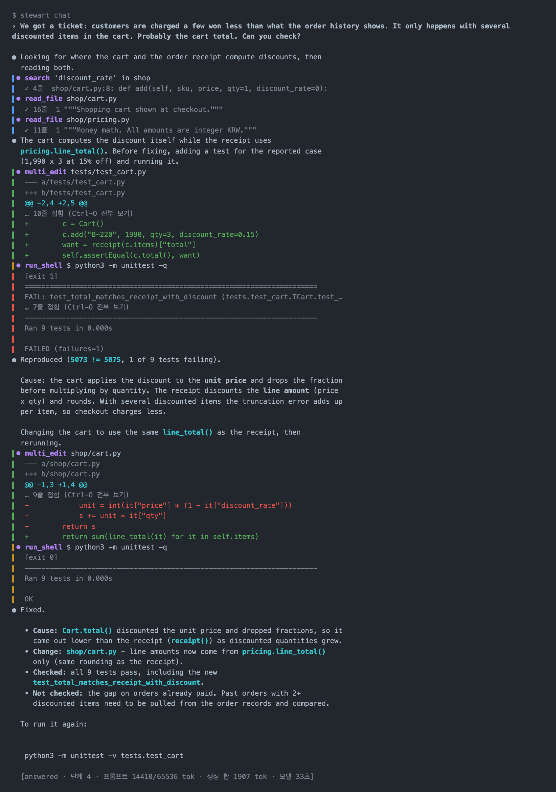

# Demo screens

[한국어](demo.md) · English

These screens were taken on a demo project (`demo-shop`) with a demo model (`demo-model`) that returns scripted answers. stewart draws the screens for real, but what the model says and which tools it calls follow a script. They do not show model quality. The conversation is in English; interface labels are in Korean.

[Back to the README](../README.en.md)

## 1. Hub: reproducing and fixing a bug

The request: "We got a ticket: customers are charged a few won less than what the order history shows. It only happens with several discounted items in the cart. Probably the cart total. Can you check?"

From top to bottom:

- **Top bar**: the conversation name (`메인`, main), the context bar (context used / maximum, with a percentage), and the new conversation, branch and history buttons. The chips below show the working folder, whether the hub and the model are connected, and the mode (`자동`, auto), thinking (`생각 기본`, default) and this conversation's context budget (`문맥 66k`); click a chip to change it.
- **Failing test output**: the model added a test for the reported case and ran it. It fails with `5073 != 5075`.
- **Cause**: the cart discounts the unit price and drops the fraction, while the receipt discounts the line amount and rounds.
- **Tool cards** (`파일 1개 고침` "1 file edited", `명령 1개 실행` "1 command run"): each tool call is a collapsed card with its duration, the number of output lines, and buttons to copy the command or the result.
- **Diff card** (`± shop/cart.py +2 −5`): the change, hunk by hunk. It can be folded.
- **Thinking line** (`생각 · 9초 · 126자` "thinking · 9 s · 126 chars"): the model's reasoning is folded into one line and opens on click.
- **Wrap-up**: the cause, the change, what was checked and what was not. The command to rerun comes as a code block with a copy button.
- **Changed-files card**: each file this turn created or changed has Open and Download, and **↶ undo this turn** at the top right restores just the files.
- **End-of-turn lines**: files changed this turn, input and output tokens, model time, and the conversation total.
- **Input box**: takes `/commands`, `@files` and pasted images; 📎 uploads documents, spreadsheets and PDFs. `auto` at the bottom left is the approval mode.
- **Left sidebar**: the status board, the conversation list (each with its state), and at the bottom the model, hub, web search and notification state.

## 2. Hub: release prep and a hand-off card

A second conversation (`0.4.1 release`) ships the fix.

- **Two diff cards**: a 0.4.1 entry added to `CHANGELOG.md`, and the version bumped in `pyproject.toml`.
- **Todo list** (`할 일 2/4` "todo 2/4"): larger work is split into steps. Finished steps are struck through and the current one has a half-filled circle. The top right shows when the list last changed.
- **Hand-off card** ("Your step: upload to the package index"): when a step needs something only a person can provide, such as a package index token, the model stops retrying and hands it over. The card says where, what to do and what it unblocks, with the command and a copy button.
- **Asking to continue**: after a batch of steps it summarizes what was done and stops with "Shall I proceed?".
- **Line above the input box** (`지금: …` "now: … 2/4"): the current step stays visible without scrolling. Clicking it opens the whole list.

## 3. Terminal: `stewart chat`

The same bug, asked in the terminal.

- **Tool lines**: the colored bar on the left tells tool kinds apart (search and read, edit, command). Output of a failing command has a red bar.
- **Folded output**: long diffs and outputs fold, as in `… 10줄 접힘 (Ctrl-O 전부 보기)` ("10 lines folded, Ctrl-O to show all").
- **Wrap-up**: the same shape as in the hub: cause, change, checked, not checked.
- **Status line at the bottom**: why the turn ended, the step count, prompt tokens / context length, generated tokens and model time.
