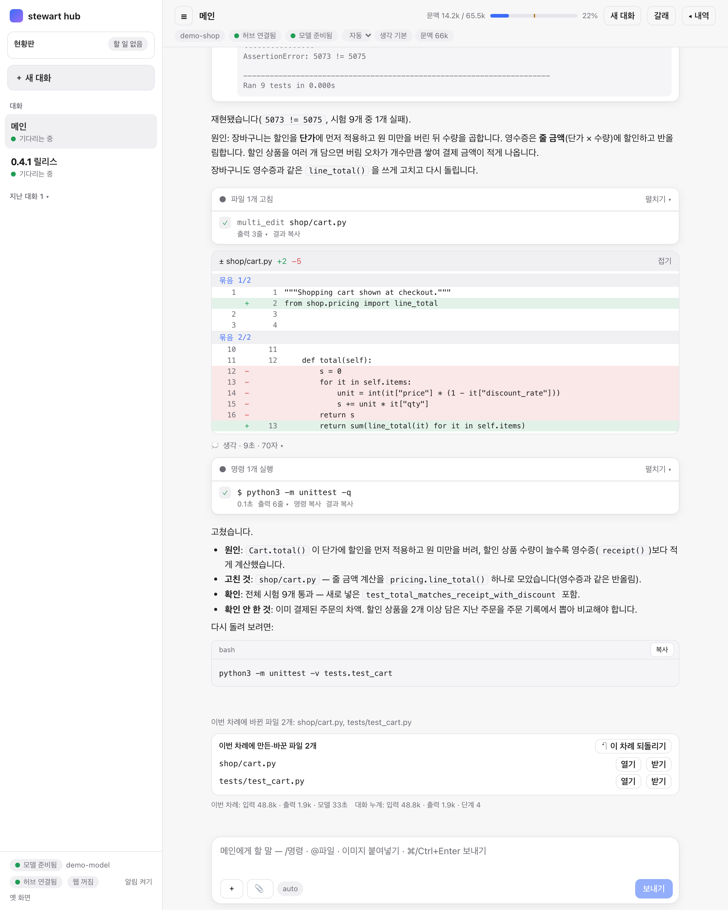
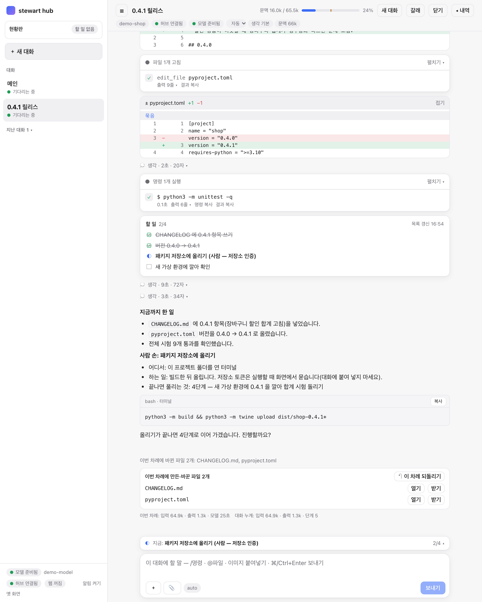
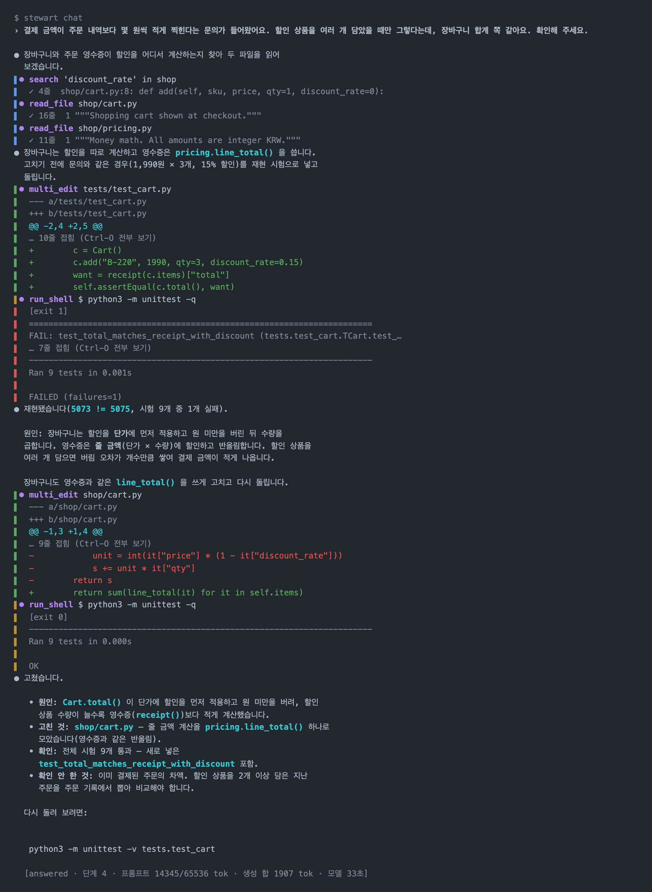

# 데모 화면

한국어 · [English](demo.en.md)

시연용 프로젝트(`demo-shop`)에서 찍은 화면입니다. 모델은 미리 정한 답을 내는 시연용 모델(`demo-model`)입니다. 화면은 실제 stewart 가 그리지만, 모델의 말과 도구 호출 순서는 대본대로입니다. 모델 성능을 보여 주는 화면이 아닙니다.

[README 로 돌아가기](../README.md)

## 1. 허브: 버그를 재현하고 고치기

시킨 일: "결제 금액이 주문 내역보다 몇 원씩 적게 찍힌다는 문의가 들어왔어요. 할인 상품을 여러 개 담았을 때만 그렇다는데, 장바구니 합계 쪽 같아요. 확인해 주세요."

화면 위에서 아래로:

- **맨 위 막대**: 대화 이름(`메인`), 문맥 막대(지금 쓴 문맥 / 최대 길이와 백분율), `새 대화`·`갈래`·`내역` 단추. 그 아래 칩은 작업 폴더 이름, 허브·모델 연결 상태, 그리고 모드(`자동`)·생각(`생각 기본`)·이 대화의 문맥 예산(`문맥 66k`)입니다. 칩을 눌러 바꿉니다.
- **실패한 시험 출력**: 모델이 문의와 같은 경우를 재현 시험으로 넣고 돌린 결과입니다. `5073 != 5075` 로 실패합니다.
- **원인 설명**: 장바구니는 단가에 할인을 먼저 적용하고 원 미만을 버리는데, 영수증은 줄 금액에 할인하고 반올림한다는 것.
- **도구 카드**(`파일 1개 고침`, `명령 1개 실행`): 도구 호출 하나하나가 카드로 접혀 있습니다. 카드마다 걸린 시간, 출력 줄 수, `명령 복사`·`결과 복사` 단추가 있습니다.
- **diff 카드**(`± shop/cart.py +2 −5`): 고친 자리를 묶음별로 보입니다. `접기` 로 닫을 수 있습니다.
- **생각 줄**(`생각 · 9초 · 70자`): 모델의 생각은 한 줄로 접혀 있고, 누르면 펼쳐집니다.
- **마무리**: 원인, 고친 것, 확인한 것, 확인하지 않은 것을 나눠 적습니다. 다시 돌려 볼 명령은 `복사` 단추가 있는 코드 블록으로 줍니다.
- **만든·바꾼 파일 카드**: 이번 차례에 만들거나 바꾼 파일마다 [열기]·[받기]가 있고, 오른쪽 위 **↶ 이 차례 되돌리기**로 파일만 그 차례 전으로 되돌립니다.
- **차례 끝 줄**: 이번 차례에 바뀐 파일, 입력·출력 토큰, 모델 시간, 대화 누계.
- **입력 칸**: `/명령`, `@파일`, 이미지 붙여넣기를 받습니다. 📎 로 문서·표·PDF 를 올립니다. 왼쪽 아래 `auto` 는 승인 모드입니다.
- **왼쪽 옆 막대**: 현황판, 대화 목록(대화마다 상태), 아래쪽에 모델·허브·웹 검색·알림 상태.

## 2. 허브: 릴리스 준비와 사람 손 카드

두 번째 대화(`0.4.1 릴리스`)에서 고친 버그를 릴리스로 내보냅니다.

- **diff 카드 둘**: `CHANGELOG.md` 에 0.4.1 항목을 더하고, `pyproject.toml` 의 버전을 올렸습니다.
- **할 일 목록**(`할 일 2/4`): 큰 일은 단계로 나눠 보입니다. 끝난 단계는 줄이 그어지고, 지금 단계는 반쯤 찬 동그라미로 표시됩니다. 오른쪽 위에 목록을 마지막으로 고친 시각이 있습니다.
- **사람 손 카드**(`사람 손: 패키지 저장소에 올리기`): 저장소 토큰처럼 사람만 넣을 수 있는 것이 필요하면, 모델이 같은 시도를 되풀이하지 않고 사람에게 넘깁니다. 어디서, 무엇을 하는지, 끝나면 무엇이 풀리는지를 적고 돌릴 명령을 복사 단추와 함께 줍니다.
- **계속할지 묻기**: 묶음이 끝나면 지금까지 한 일을 요약하고 "진행할까요?" 하고 멈춥니다.
- **입력 칸 위 줄**(`지금: … 2/4`): 대화를 내려 보지 않아도 지금 단계가 보입니다. 누르면 할 일 목록이 펼쳐집니다.

## 3. 터미널: `stewart chat`

같은 버그를 터미널에서 시킨 화면입니다.

- **도구 줄**: 왼쪽 색 막대가 도구 종류를 가릅니다(찾기·읽기, 고치기, 명령). 실패한 명령의 출력은 빨간 막대로 보입니다.
- **접힌 출력**: 긴 diff·출력은 `… 10줄 접힘 (Ctrl-O 전부 보기)` 처럼 접힙니다.
- **마무리**: 허브와 같은 꼴로 원인·고친 것·확인한 것·확인하지 않은 것을 적습니다.
- **맨 아래 상태 줄**: 끝난 까닭, 단계 수, 프롬프트 토큰 / 문맥 길이, 생성 토큰 합, 모델 시간.
